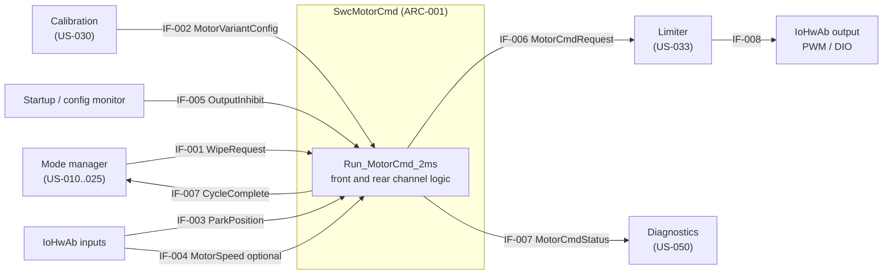
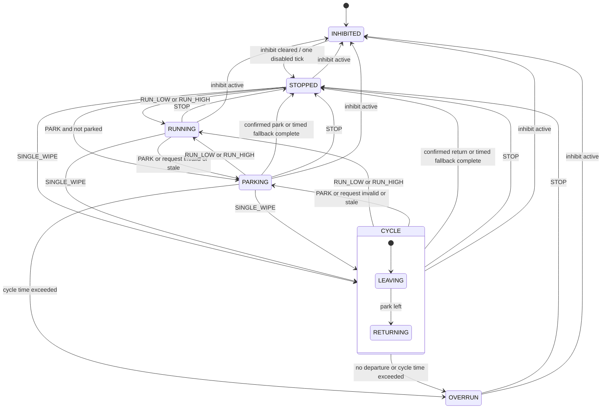
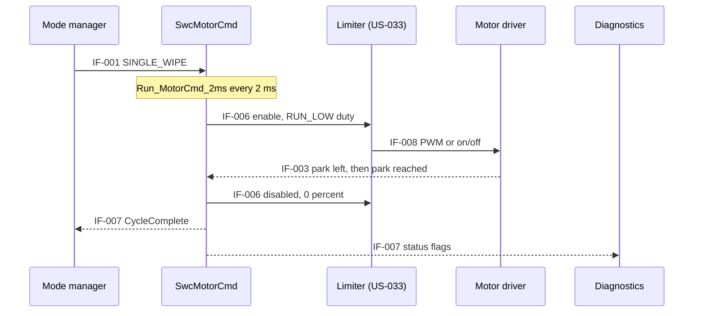

# US-032 (SCRUM-7): Motor Command Generation

| Field | Value |
|-------|-------|
| Story | SCRUM-7 / US-032 |
| PRD trace | Primary: PR-022. Supports: PR-003, PR-005, PR-020, PR-021, PR-041, PR-042, PR-043, PR-044, PR-045, PR-046, PR-060, PR-061, PR-062, PR-063 |
| Size | L |
| Status | Draft, revision 4; attempt 2 complete for independent Design Reviewer; not approved for implementation |
| Delivery identity | SCRUM-7 explicitly approved as the exception to the WIPC default; retain this existing design path |
| Requirements source | Parent-verified live Story, project SCRUM/Wiper_Control, site https://rganu123.atlassian.net; requirement revision 2026-10-27T11:54:23.254+0530; latest parent-fetched metadata revision 2026-10-27T17:06:12.894+0530; no requirements edit reported |
| Approved logical-unit toolchain | C + CMake/CTest + Unity, host executable; Python helpers are not the production toolchain |

## 1. Story Summary

**Story:** As a controller, I want to generate motor commands through the driver, so that the wiper moves as requested.

**Acceptance criteria (as received)**
- AC1: Given a wipe request, when the control task runs, then the motor driver receives the corresponding command (PWM or equivalent).
- AC2: Given feedback is required by the control strategy, when it is available, then it is used in the command calculation.

**Decisions taken (user, 2026-10-27)**
- Driver OFF sends `PARK` to this component (issued by US-011).
- A lost or invalid request is treated as `PARK`.
- The limiter (US-033) sits after this component. The duty cap on the commanded duty is owned by US-032.
- A `CycleComplete` flag in the status output tells the upstream intermittent logic that a single wipe has finished.
- The six exact proposals previously recorded as questions 21 to 26 are now approved user decisions (section 5.6). Timed parking is approved logical behavior, not an assumed industry standard or proof of physical parking. Product durations remain configured.
- The command parameters this design needs are added to US-030.

**Source and progress boundary:** The parent supplied the unchanged live Story snapshot above, labels `US-032`, `size-L`, `motor`, hard dependency US-030, soft motor-driver selection, and no issue links. This attempt reuses that explicitly authorized snapshot; it did not independently re-fetch Jira or substitute a WIPC issue. Parent-verified requester Gana Pathy: `712020:215e2721-1d23-47ea-8007-3d257056f3c0`, In Progress; receipts: workflow-start `10000`, design-start `10001`, blocked-result `10002`, attempt-2 start/decisions `10003`. Parent owns the attempt-2 result comment and synchronization before reviewer dispatch; no duplicate Jira writes here.

**Out of scope (owned by other stories):**
- Torque, current and speed limit enforcement (US-033).
- Stall and overload detection (US-034).
- Variant parameter values and validation (US-030, US-031).
- Wipe-request decisions, intermittent timing, and mode priority (US-010 to US-013, US-021, US-025).
- Fault storage and reporting (US-050, US-053).
- Thermal derating (US-040 to US-043).

**Scope:** Front and rear motor channels (AGENTS.md). The rear channel is single speed.

**Valid feedback:** qualification is deterministic in section 5.6; freshness, debounce, ranges and plausibility durations are configuration, not invented product defaults.

## 2. Requirements

Request modes (design-defined, see IF-001): `STOP`, `PARK`, `RUN_LOW`, `RUN_HIGH`, `SINGLE_WIPE`.

| ID | Requirement | Rationale | Verification | Trace |
|----|-------------|-----------|--------------|-------|
| REQ-F-001 | For each motor channel (front, rear), the software shall calculate and output one motor command in every execution of the 2 ms control task. | Deterministic command update tied to the 500 Hz task. | Test (TC-001) | AC1, PR-022, PR-020 |
| REQ-F-002 | The software shall map the requests `RUN_LOW` and `RUN_HIGH` to the duty defined for that step in the channel's variant parameter set. | The S/M/L variants have different parameters; labels alone must not set values. | Test (TC-002) | AC1, PR-022, PR-041 |
| REQ-F-003 | The software shall output each command as an enable flag plus a duty value (0 % to 100 %) on an abstract output interface that can be mapped to a PWM driver or an on/off driver, selected by the variant parameter set. | Supports "PWM or equivalent" without fixing the driver. | Test (TC-003) | AC1, PR-022 |
| REQ-F-004 | An eligible effective request change shall update IF-006 by the next control execution (target period 2 ms), subject to inhibit, the one-tick release barrier, latched overrun and completed-entry hold in section 5.6; added driver-pin delay is TBD. | Next-invocation response respects the approved motion guards; target jitter/tolerance remains item 27. | Timing measurement (TC-001, TC-027) | AC1, PR-022, PR-020 |
| REQ-F-005 | On each effective-mode entry to `SINGLE_WIPE`, the software shall command the bounded low-step duty until a valid debounced departure and return, or approved timed completion under REQ-F-020, then remain stopped until the effective mode changes. | One wipe per entry; a cycle starting at park must not end at once. | Test (TC-004) | AC1, PR-003 |
| REQ-F-006 | On effective PARK entry with usable park feedback, the software shall command bounded low-step duty until confirmed PARKED, then stay disabled for that entry; already-confirmed PARKED shall remain disabled. Without usable feedback REQ-F-020 applies. | Confirmed park is preferred; timed fallback does not guarantee a clear field of view. | Test (TC-005) | AC1, PR-005 |
| REQ-F-007 | When park-position feedback is configured available and valid for a channel, the software shall use it to detect the park position for REQ-F-005 and REQ-F-006. | Feedback use required by AC2. | Test (TC-006) | AC2, PR-022 |
| REQ-F-008 | For a moving state with configured valid speed feedback, the software shall calculate duty as `clamp(base + Kp * (targetHz - measuredHz), 0, stepMax)` using finite double inputs and intermediate arithmetic, with no integral or history term (section 5.6). | User-approved proportional strategy uses AC2 feedback reproducibly. | Test (TC-007) | AC2, PR-022 |
| REQ-F-009 | When speed feedback configured as available is invalid or missing, the software shall calculate the command without the correction (open loop) and shall set `FeedbackDegraded` for that channel. | Avoids a wrong command from bad feedback while keeping the wiper working. | Fault injection (TC-008) | AC2, PR-062 |
| REQ-F-010 | When no feedback is configured for a channel, the software shall calculate the command open loop and shall not set `FeedbackDegraded`. | Variants and hardware may have no feedback (PRD open question 5). | Test (TC-009) | AC2, PR-022 |
| REQ-F-011 | While inhibit is active, the channel shall be disabled at 0 % in `INHIBITED`; the first execution after release shall be disabled in `STOPPED`, before evaluating held motion on the following execution. | User-approved one-tick release barrier prevents immediate motion. | Test (TC-010) | PR-063, PR-046 |
| REQ-F-012 | When a wipe request has an undefined value or a mode not allowed for the channel, the software shall treat it as `PARK` and set `RequestInvalid`. | A defined, safe reaction to a corrupt request (decision 2). | Fault injection (TC-011) | PR-062 |
| REQ-F-013 | A change of request, state, or fault of one channel shall not change the command of the other channel. | A front fault must not stop the rear wiper, and the reverse. | Test (TC-012) | PR-022 |
| REQ-F-014 | The software shall output, per channel, a status containing the channel state, `FeedbackDegraded`, `RequestInvalid`, and `CycleOverrun`, updated every execution of the control task. | Lets diagnostics (US-050) record faults. | Test (TC-013) | PR-060 |
| REQ-F-015 | An incomplete `PARK` or `SINGLE_WIPE` shall disable and enter `OVERRUN` at elapsed time greater than or equal to configured maximum cycle time from original mode entry; valid confirmed completion in that execution wins the timeout. | Bounds attempted parking even through feedback loss/recovery. | Fault injection (TC-017) | PR-044, PR-045 |
| REQ-F-016 | On `STOP`, the software shall disable the output at 0 % in the same execution, from any state except `INHIBITED`. | Immediate stop on an explicit request; a driver OFF uses `PARK` instead. | Test (TC-019) | PR-005, PR-063 |
| REQ-F-017 | Enable shall equal bounded duty greater than 0 %; a digital driver shall have one ON output equal to enable. Front `RUN_HIGH` uses its configured duty but the same ON output; rear `RUN_HIGH` is invalid. | User-approved equivalent output; no physical speed distinction is claimed for a single digital line. | Test (TC-003) | AC1, PR-022 |
| REQ-F-018 | During `SINGLE_WIPE`, if departure has not been observed and park feedback is valid, elapsed time greater than or equal to configured departure time from original cycle entry shall cause `OVERRUN`; invalid/absent park feedback suppresses only this departure check. | User-approved departure supervision without restarting timers on feedback recovery. | Fault injection (TC-020) | PR-044, PR-045 |
| REQ-F-019 | The software shall limit the corrected duty to the range 0 % to the maximum duty of the active step defined in the variant parameter set. | Caps the closed-loop correction (decision 3); the envelope limits stay with US-033. | Test (TC-021) | PR-042, PR-043 |
| REQ-F-020 | With absent/invalid park feedback, `PARK` and `SINGLE_WIPE` shall stop when elapsed time from original mode entry reaches the configured timed-park duration, subject to overall timeout; loss/recovery shall not restart timing. Valid confirmed park may complete earlier. Completed `PARK` shall remain stopped until effective mode changes. | Approved bounded fallback does not prove physical parking. | Test (TC-022) | AC2, PR-062 |
| REQ-F-021 | When a wipe request is not refreshed within the request timeout (TBD), the software shall treat it as `PARK` and set `RequestInvalid`. | A defined, safe reaction to a lost request (decision 2). | Fault injection (TC-023) | PR-062 |
| REQ-F-022 | `CycleComplete` shall be set on normal or timed `SINGLE_WIPE` completion, never on overrun or `PARK` completion, and held until effective mode changes; identical refreshed requests shall not clear it or re-arm motion. | User-approved completion latch for upstream interval logic. | Test (TC-024) | PR-003 |
| REQ-F-023 | `RequestInvalid` and `FeedbackDegraded` shall clear when their causes clear under section 5.6. `CycleOverrun` shall stay set in disabled OVERRUN until valid STOP or inhibit; other requests shall not clear it or enable motion. | Deterministic recovery per PR-061; no automatic retry in this unit. | Test (TC-025) | PR-061 |
| REQ-F-024 | During `RUN_LOW`/`RUN_HIGH`, no fresh debounced park edge for the configured plausibility duration shall latch a stuck-park fault; only a fresh debounced opposite-value edge shall clear that fault. Invalid park samples reset debounce; speed validity requires freshness, finite value and configured range, with recovery on a new valid sample. | Approved signal supervision, not optical/mechanical plausibility or stall detection. | Fault injection (TC-026) | PR-060, PR-062 |
| REQ-N-001 | The command runnable shall complete within an execution-time share of the 2 ms task period (TBD, set by US-002). | Keeps the 500 Hz deadline. | WCET analysis (TC-014) | PR-021 |
| REQ-N-002 | Before initialization is complete and after any reset, the command output shall be disabled at 0 %. | No motion before the software is ready. | HIL (TC-015) | PR-063 |
| REQ-N-003 | The duty resolution shall be TBD (set by the selected driver and timer). | The resolution depends on hardware not yet selected. | Test (TC-016) | PR-022 |

**Gaps against the PRD**
- PR-022 requires a "compatible motor driver". Compatibility cannot be verified until the driver is selected (soft dependency).
- PR-022 says feedback is used "where required by the selected control strategy". The user has now approved the proportional and parking strategies; hardware availability and calibration remain conditional on configuration (PRD open question 5).
- `SINGLE_WIPE`, `OVERRUN`, `CycleComplete` and signal-edge supervision are user-approved derived software mechanics supporting PR-003, PR-005, PR-044 and PR-045, not added PRD text. Upstream interface adoption remains integration work.

## 3. Dependencies

| Dependency | Type | Needed for | Status |
|------------|------|------------|--------|
| US-030 Motor variant parameter sets | Hard | Duty per step, maximum duty, output type, feedback flags, correction and timing parameters (IF-002). Requested in the local US-030 acceptance criteria. | Live status unverified; configuration fixture in logical tests |
| Motor driver selection | Soft | Output mapping, PWM frequency, duty resolution, driver default state | Open |
| US-001 Periodic 2 ms control task | Soft (additional, not in the story list) | Execution of the runnable | Stub scheduler in tests |
| US-011, US-012, US-013, US-021, US-025 | Soft (additional) | Source of wipe requests (IF-001); US-011 issues `PARK` on driver OFF; US-013 and US-021 consume `CycleComplete` | Stub in tests |
| US-031 / US-052 | Soft (additional) | Source of the per-channel inhibit (IF-005) | Stub in tests |
| US-050 | Soft | Consumer of the status (IF-007) | Stub in tests |
| Limiter interface (IF-006), owned with US-033 | Soft (interface only) | Consumer of the command. US-033 is hard-dependent on US-032, not the reverse. | Stub in tests |

The additional soft dependencies are not in [user_stories.md](../../user_stories.md); only the US-030 entry was updated there.

## 4. Interfaces

| ID | Signal / API | Direction | Source | Destination | Type, range, unit | Cycle / timeout | Invalid value |
|----|--------------|-----------|--------|-------------|-------------------|-----------------|---------------|
| IF-001 | WipeRequest (one per channel) | In | Mode manager (US-010 to US-025) | SwcMotorCmd | Enum: `STOP`, `PARK`, `RUN_LOW`, `RUN_HIGH`, `SINGLE_WIPE`. Rear channel allows `STOP`, `PARK`, `RUN_LOW`, `SINGLE_WIPE`. | 2 ms / timeout TBD | Undefined value: treated as `PARK` |
| IF-002 | MotorVariantConfig (per channel), parameters requested from US-030 | In | Calibration (US-030) | SwcMotorCmd | S/M/L, PWM/digital, feedback flags, low/high base/max duty (%), target (Hz), Kp (%/Hz), speed range (Hz), durations (ms); exact logical schema in 5.6; product values TBD | Copy at init; reset to change | Missing/invalid: inhibited (US-031) |
| IF-003 | ParkPosition (per channel) | In | IoHwAb | SwcMotorCmd | Enum: `PARKED`, `NOT_PARKED`, `INVALID`; debounce TBD | 2 ms / timeout TBD | `INVALID` |
| IF-004 | MotorSpeed (per channel, optional) | In | IoHwAb | SwcMotorCmd | Double, configured inclusive range in Hz (wipe cycles per second); sample-valid flag and timestamp | 2 ms / configured freshness TBD | Missing, invalid, stale, future timestamp, nonfinite or out of range |
| IF-005 | OutputInhibit (per channel) | In | Startup / configuration monitor (US-031, US-052) | SwcMotorCmd | Boolean | 2 ms | Active (inhibit) |
| IF-006 | MotorCmdRequest (per channel) | Out | SwcMotorCmd | Limiter (US-033), then IoHwAb | Enable: boolean; duty: 0 % to 100 %, resolution TBD | 2 ms | Enable false, 0 % |
| IF-007 | MotorCmdStatus (per channel) | Out | SwcMotorCmd | Mode manager (`CycleComplete`) and Diagnostics (US-050) | Struct: state enum, `FeedbackDegraded`, `RequestInvalid`, `CycleOverrun`, `CycleComplete` (booleans) | 2 ms | All fault flags set, `CycleComplete` false |
| IF-008 | Driver output (PWM or digital) | Out | IoHwAb | Motor driver hardware | Signal names, PWM frequency: TBD | Per driver | Disabled |

## 5. Design

### 5.1 Component structure

| ID | Element | Description |
|----|---------|-------------|
| ARC-001 | SwcMotorCmd | AUTOSAR SWC with one runnable `Run_MotorCmd_2ms` (period 2 ms, in the control task). It holds one instance of the channel logic per motor (front, rear). |
| ARC-002 | Channel state machine | Per channel; states in section 5.2. |
| ARC-003 | Command calculator | Looks up duty for the active step in IF-002, applies the closed-loop correction when speed feedback is valid, limits the result to the maximum duty (REQ-F-019), and outputs IF-006. |
| ARC-004 | Output mapping | Maps IF-006 to PWM or on/off according to IF-002; implemented in IoHwAb/MCAL (TBD by driver selection). |
| ARC-005 | Feedback monitor | Applies timeout and plausibility checks to IF-003 and IF-004 and provides the "valid" flags used by the state machine and calculator. |

Ports of SwcMotorCmd: R-ports IF-001, IF-002, IF-003, IF-004, IF-005; P-ports IF-006, IF-007.

### 5.2 Channel behaviour

| State | Output |
|-------|--------|
| INHIBITED | Disabled, 0 % |
| STOPPED | Disabled, 0 % |
| RUNNING | Duty of the active step |
| CYCLE | `RUN_LOW` duty until the wiper has left and returned to park |
| PARKING | `RUN_LOW` duty until park reached |
| OVERRUN | Disabled, latched until `STOP` or inhibit |

The diagram summarizes transitions; section 5.6 defines guards and priority. A consumed `PARK` or `SINGLE_WIPE` entry cannot restart from `STOPPED` on refresh. Timed completion sets `CycleComplete` only for `SINGLE_WIPE`, and is not evidence of physical park.

### 5.3 Command sequence

### 5.4 Error handling

| Condition | Reaction |
|-----------|----------|
| Inhibit active | Disabled, state INHIBITED (REQ-F-011) |
| Request undefined or mode not allowed | Treated as `PARK`, `RequestInvalid` set (REQ-F-012) |
| Request not refreshed in time | Treated as `PARK`, `RequestInvalid` set (REQ-F-021) |
| Speed feedback invalid | Open loop, `FeedbackDegraded` set (REQ-F-009) |
| Park feedback invalid or not configured | Time-based park cycle (REQ-F-020) |
| Park signal implausible | Park feedback treated as invalid, `FeedbackDegraded` set (REQ-F-024) |
| Park not left or not reached in time | Disabled, `OVERRUN`, `CycleOverrun` set (REQ-F-015, REQ-F-018) |

### 5.5 Design decisions

| Decision | Alternatives considered | Reason |
|----------|-------------------------|--------|
| Abstract output (enable + duty), mapped per variant | Fix the SWC to PWM only | Driver is not selected; keeps the SWC reusable across S/M/L and for the on/off alternative. |
| Command generation separate from limiting; limiter after this component (user decision) | Limit inside this SWC | Matches the story split; the limiter can be tested on its own. |
| Duty cap on the corrected duty owned by this story | Cap in US-033 only | The correction is applied here, so the cap must be applied here; US-033 still limits torque, current and speed. |
| Open-loop baseline with optional park and speed feedback | Closed loop mandatory | Feedback availability is open (PRD open question 5). |
| Motor-side single wipe cycle (`SINGLE_WIPE`) with `CycleComplete` | Upper layer runs and stops the motor | Needs park feedback close to the motor output; the interval timing stays upstream. |
| Latched `OVERRUN` state cleared by `STOP` or inhibit | Auto-restart on the next request | Avoids repeatedly driving a blocked wiper; a retry limit is left to US-034 and US-050. |
| No supply-voltage compensation specified in this draft | Scale duty by supply voltage | Neither supply voltage nor the need for compensation is confirmed (open item 4); do not infer a production rating or compensation algorithm. |

### 5.6 Approved logical C contract

This is a design contract, not production source. Use C + CMake/CTest + Unity. Two independent caller-owned `MotorCmdChannel` instances represent front/rear; no global clock, allocation, hidden IO or shared mutable state. Keep ARC-002, ARC-003 and ARC-005 real in tests. API names and representation below are derived software mechanics implementing user decisions 21 to 26, not assumed standards or motor ratings.

**Callable surface:** `void MotorCmd_Init(MotorCmdChannel *state, const MotorCmdConfig *config, uint64_t now_ms)` and `void MotorCmd_Step(MotorCmdChannel *state, const MotorCmdInput *input, MotorCmdOutput *output)`. All pointers must be non-null; configuration must satisfy the schema below and remain fixed until reset. US-031 owns validation and supplies `inhibit=true` if configuration is unapproved; invalid configuration must not be passed as a validated fixture. Init copies configuration, resets all history/flags to absent/false, enters INHIBITED and sets stored command disabled/0 %, digital_on=false and all four status flags false. The public `MotorCmdChannel.output` member has type `MotorCmdOutput` and exposes that initial snapshot; Step overwrites it and copies it to the supplied output. Other internal layout is implementation-owned. Adapter keeps hardware disabled before Init. Neither API proves pre-init pin behavior. API use is single-threaded per instance; snapshots are coherent caller-owned inputs, not asynchronous live buffers.

| Logical C type | Required fields / meaning |
|----------------|---------------------------|
| `MotorCmdMode` | Defined integer enum `STOP=0`, `PARK=1`, `RUN_LOW=2`, `RUN_HIGH=3`, `SINGLE_WIPE=4`; input uses `int32_t mode` so undefined values can be injected |
| `MotorCmdConfig` | Channel enum FRONT/REAR; variant enum S/M/L; output enum PWM/DIGITAL; `bool park_available, speed_available`; `MotorCmdStepConfig low, high`; `double speed_min_hz, speed_max_hz`; `uint64_t request_timeout_ms, park_freshness_ms, speed_freshness_ms, park_debounce_ms, timed_park_ms, departure_timeout_ms, cycle_timeout_ms, park_plausibility_ms` |
| `MotorCmdStepConfig` | `double base_duty_pct, max_duty_pct, target_hz, kp_pct_per_hz`; all finite; `0 <= base <= max <= 100`, nonnegative Kp, target within configured nonnegative inclusive speed range. PARK/SINGLE_WIPE use low. Rear high is unused, never a supported mode |
| Timing configuration | Durations are positive whole milliseconds except debounce may be zero; no default relationship is inferred between timed, departure and overall durations. Overall timeout can preempt timed fallback. Production values and acceptance tolerances remain TBD (items 8, 9, 11, 27) |
| `MotorCmdInput` | `uint64_t now_ms`; `bool inhibit`; request record `{bool present; int32_t mode; uint64_t refreshed_ms;}`; park record `{bool present, valid, parked; uint64_t sampled_ms;}`; speed record `{bool present, valid; double hz; uint64_t sampled_ms;}` |
| Input snapshot semantics | Each call contains latest received records, not update pulses; `present=false` means no sample retained. A refresh updates `refreshed_ms` even for identical mode; feedback timestamps change only on reception. Reusing the same sample does not refresh it. Caller provides ordered samples in the injected clock domain |
| `MotorCmdChannel` | Copied config; public state enum INHIBITED/STOPPED/RUNNING/CYCLE/PARKING/OVERRUN; stored command/status; effective-mode-present flag and last effective mode; consumed-entry latch; cycle start and departed flag; park candidate/value/start, debounced baseline/value, last qualifying edge, last received timestamps; continuous-run supervision start; stuck-park latch. Internal layout is implementation-owned; tests observe only Init output and Step output |
| `MotorCmdOutput` | `bool enable`; `double duty_pct`; `bool digital_on`; state enum; `bool FeedbackDegraded, RequestInvalid, CycleOverrun, CycleComplete`. No other physical-success flag is implied |

**Clock and requests (decisions 23/24).** `now_ms` is injected monotonic nondecreasing whole milliseconds without wrap during an initialized instance; reset starts a new epoch. Future timestamps are invalid inputs; never unsigned-subtract them. For all freshness checks require `sampled/refreshed_ms <= now_ms` and age strictly less than configured timeout. Thus age equal to timeout is stale. Elapsed timers expire at `elapsed >= duration`; Step reacts on the first invocation meeting the guard, not asynchronously between calls. Request is invalid if missing/stale/undefined or rear RUN_HIGH; substitute effective PARK and set `RequestInvalid`. Otherwise use requested mode and clear the flag. Mode change means **effective enum change**, not raw invalid-value change, receipt, refresh or timestamp change. Repeated invalid/PARK inputs share the same PARK entry, even when invalidity clears to a valid PARK.

On effective-mode change, clear `CycleComplete` and consumed-entry latch; entry to PARK/SINGLE_WIPE records `cycle_start_ms=now_ms`, clears departed, and consumes that entry. A completed entry remains consumed in STOPPED, so an identical held/refreshed mode never restarts it. Entry from running to PARK or SINGLE_WIPE starts that new mode's timer; feedback loss/recovery never does. After inhibit, discard the previous entry/history of cycle completion; the release tick does not consume a held motion entry. Next tick evaluates it as a new entry. No retry loop is provided. STOP/inhibit clear the overrun latch; other modes cannot do so.

**Feedback qualification (decision 25).** A park sample is transport-valid only if configured, present, valid and fresh. Invalidity clears candidate continuity and current park qualification immediately, but retains the last accepted debounced baseline for edge recovery. A changed candidate starts at the invocation's `now_ms` (no retroactive debounce from sample timestamp); it qualifies when it stays the same on valid/fresh invocations for `elapsed >= park_debounce_ms`. While debouncing a changed valid candidate, the previously qualified value stays usable; after any invalidity, neither value is usable until qualification completes again. Zero debounce qualifies immediately. Repeated invocations may qualify a retained still-fresh sample; freshness is still mandatory on the qualification tick. An initial debounced value establishes a baseline, not an edge. A qualified opposite value is an edge; same-value recovery is not. Current park usability requires qualification and no stuck latch. Monitoring/debounce continues in stopped and inhibited states so an actual fresh edge may recover the stuck fault there; inhibit alone cannot do so.

During continuous RUN_LOW/RUN_HIGH, start the no-edge timer on continuous-run entry (a low/high switch does not restart it); every qualified opposite edge restarts it. If a baseline exists, feedback is currently qualified, and no edge arrives for `park_plausibility_ms`, latch stuck park. No supervision accrues outside continuous running; re-entry starts a new interval. Evaluate a new edge before the stuck deadline in the same tick. The debouncer continues while stuck, so only a new fresh debounced opposite edge clears the latch; STOP/inhibit or same-value refresh do not clear it (reset does). This checks signal edges only, not optics, actual movement, phase or mechanics.

Speed is usable only if configured/present/valid/fresh, finite and within `[speed_min_hz, speed_max_hz]` inclusive. A new qualifying speed sample restores usability without hysteresis. `FeedbackDegraded` each tick is the OR of unusable configured park feedback, unusable configured speed feedback and any current nonfinite correction result; unconfigured feedback contributes false, in all states. `RequestInvalid` is similarly recomputed even while inhibited/overrun; neither flag is latched.

**Calculation and mapping (decisions 21/26).** For RUNNING, CYCLE or PARKING choose the active step (low for CYCLE/PARKING). If speed is usable, calculate separate double operations `error = target - measured`, `correction = Kp * error`, `raw = base + correction`; require each finite. A nonfinite intermediate is unusable correction: use base and set `FeedbackDegraded` that tick, like invalid speed. Otherwise clamp raw to `[0, stepMax]`; without usable speed clamp base to that range. No integral, previous-speed or controller history exists. Do not quantize or round in the logical unit; hardware conversion belongs to ARC-004. In every stopped/overrun/inhibited state set duty to exactly 0. `enable = (duty_pct > 0)`. DIGITAL uses `digital_on=enable`; PWM sets `digital_on=false` (not applicable) and publishes enable/duty. Digital front high uses its configured step in calculation but cannot demonstrate physical low/high distinction. Rear high maps to invalid/PARK.

**Per-tick priority and completion (decisions 22/24).** Qualify inputs first, then apply this ordered transition table; compute command from the resulting state in that same call.

| Priority / guard | Action / linked requirements |
|------------------|------------------------------|
| Inhibit active | INHIBITED, disabled, clear overrun and cycle completion/entry; ignore motion (REQ-F-011) |
| Previous state INHIBITED, inhibit now clear | STOPPED, disabled for this whole tick, clear overrun/completion, defer motion entry (REQ-F-011) |
| Valid effective STOP | STOPPED, disabled, clear overrun; process mode change (REQ-F-016, REQ-F-023) |
| Latched OVERRUN | Remain disabled, no completion; ignore all motion including fallback PARK (REQ-F-023) |
| Other effective-mode change | Clear completion; RUN modes enter RUNNING; PARK enters PARKING; SINGLE_WIPE enters CYCLE with original timer as above (REQ-F-005, REQ-F-006) |
| PARKING and usable PARKED | Confirmed completion, STOPPED; no CycleComplete (REQ-F-006, REQ-F-007) |
| CYCLE and usable NOT_PARKED | Record departed even if cycle began away from park; this is not completion (REQ-F-005) |
| CYCLE and departed and usable PARKED | Confirmed completion, STOPPED, CycleComplete=true (REQ-F-005, REQ-F-022) |
| Still active PARKING/CYCLE and overall elapsed >= cycle timeout | OVERRUN, disabled, CycleOverrun=true, CycleComplete=false (REQ-F-015) |
| Still CYCLE, not departed, usable park and elapsed >= departure timeout | OVERRUN, same flags (REQ-F-018) |
| Still active PARKING/CYCLE, park unusable and elapsed >= timed park | Timed completion, STOPPED; CycleComplete=true only for CYCLE (REQ-F-020, REQ-F-022) |
| Otherwise | Keep state and bounded step command; consumed completion stays STOPPED (REQ-F-002, REQ-F-019) |

Confirmed completion therefore wins a same-tick timeout; timed completion does not override overall timeout. Inhibit/STOP override all motion/completion. Feedback recovery uses the same original start, and departure timeout is evaluated immediately if feedback becomes usable without an observed departure. Timed fallback does not remain eligible once feedback is usable: continue departure/return supervision with the original overall deadline. No claim of physical park or reliable stall detection follows from timed completion.

| Resolved item | User-approved oracle incorporated | Requirement / test IDs |
|---------------|-----------------------------------|-----------------------|
| 21 | Proportional finite-double correction, no integral/history; invalid speed uses capped base | REQ-F-008, REQ-F-009, REQ-F-019 / TC-007, TC-008, TC-021 |
| 22 | Bounded timed parking with original start, feedback recovery and completion rules | REQ-F-005, REQ-F-006, REQ-F-015, REQ-F-018, REQ-F-020, REQ-F-022 / TC-004, TC-005, TC-017, TC-020, TC-022, TC-024 |
| 23 | One cycle per effective-mode entry; refresh preserves timers/completion | REQ-F-005, REQ-F-020, REQ-F-021, REQ-F-022 / TC-004, TC-022, TC-023, TC-024 |
| 24 | Inclusive expiry, confirmed-completion precedence, disabled release tick, STOP/inhibit override | REQ-F-004, REQ-F-011, REQ-F-015, REQ-F-018, REQ-F-021, REQ-F-023 / TC-001, TC-010, TC-017, TC-020, TC-023, TC-025 |
| 25 | Configured debounce/freshness, edge-only stuck recovery, finite/ranged speed recovery | REQ-F-007 to REQ-F-010, REQ-F-023, REQ-F-024 / TC-006 to TC-009, TC-025, TC-026 |
| 26 | One digital ON line, enable iff positive bounded duty, front high logical only, rear high invalid | REQ-F-003, REQ-F-017, REQ-F-019 / TC-003, TC-011, TC-021 |

## 6. Safety Considerations

No ASIL is assigned here; items are flagged for the HARA.

| ID | Hazard / fault | Detection | Reaction / safe state | Flag for HARA | Verified by |
|----|----------------|-----------|-----------------------|---------------|-------------|
| SAF-001 | Unintended motor activation (command active while `STOP`, inhibited, or before init) | State machine rules; default-disabled output | Output disabled at 0 % (REQ-F-016, REQ-F-011, REQ-N-002) | Yes: unintended wiping | TC-010, TC-015, TC-019 |
| SAF-002 | Loss of wiping because the request is lost or corrupt | Request timeout / validity check | Park, then stop (REQ-F-012, REQ-F-021); user decision, HARA to confirm against holding the last speed | Yes: loss of wiping in rain | TC-011, TC-023 |
| SAF-003 | Wrong closed-loop correction from faulty speed feedback | Feedback validity check | Open loop, `FeedbackDegraded` (REQ-F-009) | Yes: wrong speed | TC-007, TC-008 |
| SAF-004 | Motor runs on because park feedback is stuck or the wiper is blocked | Maximum wipe-cycle time; departure time | Output disabled, latched `OVERRUN` (REQ-F-015, REQ-F-018, REQ-F-023) | Yes: blocked wiper, overheating | TC-017, TC-020, TC-025 |
| SAF-005 | Command above the approved envelope reaches the driver | Duty cap here; envelope limiter in US-033 | Corrected duty limited to the step maximum (REQ-F-019); limiting by US-033 | Yes: motor overload | TC-002, TC-018, TC-021 |
| SAF-006 | Wiper stopped away from park (explicit `STOP`, inhibit, or time-based park) leaves it in the field of view | Not detectable without trustworthy park feedback | Driver OFF issues PARK, not STOP; approved timed stopping and immediate inhibit/STOP do not guarantee safe physical park | Yes: vehicle HARA must confirm visibility risk before deployment | TC-019, TC-022 |
| SAF-007 | Stuck or false `PARKED` ends parking with the wiper in view | Plausibility check of the park signal | Park feedback marked implausible, `FeedbackDegraded`, time-based park (REQ-F-024, REQ-F-020) | Yes: wiper in the field of view | TC-026 |

## 7. Verification

Independent test approach: use host-executable C logical units with Unity through CMake/CTest. Inject clock, request refresh, park/speed samples, inhibit and complete US-030 configuration fixtures; spy on IF-006/IF-007 and mock only downstream limiter/driver transport. No unit-under-test substitution. US-030 remains the hard integration dependency; fixtures allow independent logical testing.

**Synthetic fixture, not product ratings:** front PWM, both feedback flags false unless enabled by a case; low `{base=40 %, max=70 %, target=2 Hz, Kp=10 %/Hz}`, high `{60 %, 90 %, 3 Hz, 10 %/Hz}`; speed range `[0,10] Hz`; request timeout 50 ms, park/speed freshness 10 ms, debounce 4 ms, timed park 20 ms, departure 12 ms, overall 40 ms, plausibility 16 ms. Start epoch at 0 ms; Init, release at 0 ms (disabled), first motion at 2 ms. Refresh request each tested motion invocation unless testing expiry; refresh enabled feedback each invocation unless testing freshness. Other booleans false unless specified; record expected tuple `(state, duty_pct, enable, digital_on, RequestInvalid, FeedbackDegraded, CycleOverrun, CycleComplete)` for every step using section 5.6. Discrete outputs/times are exact; double comparisons use host assertion tolerance `1e-9` percentage points (test-only arithmetic tolerance, not hardware resolution). Finite-overflow cases override finite config/measurements with representable extreme values while preserving schema; never replace the real calculator with a mock.

Logical IF-006 output is not proof of compatible driver delivery under AC1. TC-018 is a stubbed hand-off check only. HIL/driver integration and target timing (TC-014 to TC-016, TC-027), including hardware startup output, remain unverified. TC-001 can verify next-invocation logic on the host but cannot establish a physical 2 ms deadline or scheduler jitter tolerance. TC-002 uses `RUN_HIGH` only on the front channel; rear `RUN_HIGH` is the invalid-request case in TC-011.

| ID | Linked requirement(s) | Preconditions | Steps | Expected result | Level |
|----|-----------------------|---------------|-------|-----------------|-------|
| TC-001 | REQ-F-001, REQ-F-004 | Runnable scheduled every 2 ms; channel `STOPPED` | Change request to `RUN_LOW`; observe IF-006 each period | A command is output every execution; the new command appears at the next execution (within 2 ms) | SIL |
| TC-002 | REQ-F-002, SAF-005, SAF-001 | Variant S, M, and L parameter sets, front and rear | Apply `RUN_LOW` and `RUN_HIGH` | Duty equals the configured value for that step; the duty never exceeds the configured maximum | SIL |
| TC-003 | REQ-F-003, REQ-F-017 | PWM and digital configurations | Apply front low/high, STOP, and zero capped duty; send rear high | Front duties 40/60, enable true; digital ON for both, PWM digital_on false; STOP/zero disable. Rear high: RequestInvalid, effective PARK, never high output | SIL |
| TC-004 | REQ-F-005 | Park configured; qualify initial PARKED before cycle entry | Enter SINGLE_WIPE; qualify NOT_PARKED then PARKED; refresh identical request after completion; change STOP then SINGLE_WIPE | CYCLE/40 until return, then STOPPED/0 and completion held; no immediate finish at starting park, no refreshed restart; changed mode re-arms. Also start away from park and observe departure then return | SIL |
| TC-005 | REQ-F-006 | Park feedback valid | Request `PARK` when not parked, then when parked | Runs at `RUN_LOW` duty until parked, then disabled; stays disabled if already parked | SIL |
| TC-006 | REQ-F-007 | Park configured; PARKING | Candidate PARKED at t; invoke at t+2 and t+4; inject invalid/stale sample during qualification and retry; test zero debounce | 40 duty before 4 ms stable, then disabled on qualification tick; invalid resets debounce, retry needs full 4 ms; zero debounce immediate; age 10 ms invalid | SIL |
| TC-007 | REQ-F-008 | Speed configured, valid/fresh; low-step fixture | Supply 1/2/3 Hz; repeat same measurements and switch high with 3 Hz; repeat in PARKING/CYCLE | Low duty 50/40/30 respectively, high at target 60; no accumulated/history correction; low-step calculation also used for PARKING/CYCLE | SIL |
| TC-008 | REQ-F-009 | Speed configured; low-step fixture | Inject missing/invalid, age 9/10/11 ms, future timestamp, NaN/infinity, below/at/above configured range; then new valid 1 Hz sample; set finite Kp=DBL_MAX and valid measured=0 Hz for multiplication overflow | Usable samples follow formula; unusable/overflow use 40 capped base and FeedbackDegraded; 0/10 Hz endpoints valid, outside invalid; new valid 1 Hz restores 50 with original Kp and clears degradation if no other cause | SIL |
| TC-009 | REQ-F-010 | No feedback configured | Run `RUN_LOW`, `RUN_HIGH`, `STOP` | Open-loop command; `FeedbackDegraded` never set | SIL |
| TC-010 | REQ-F-011, SAF-001 | Both channels RUNNING | Inhibit front with high held; release, then next tick; repeat from CYCLE/OVERRUN | Front INHIBITED/0, release STOPPED/0 for one whole tick, next tick fresh entry RUNNING/60; rear unaffected; inhibit clears overrun/completion, stuck-park only clears by edge/reset | SIL |
| TC-011 | REQ-F-012, SAF-002 | Channel `RUNNING` | Send an undefined value; send `RUN_HIGH` on the rear channel | Each case acts as `PARK`; `RequestInvalid` set | SIL |
| TC-012 | REQ-F-013 | Both channels `RUNNING` | Inject a request, feedback, or timeout fault on one channel | The other channel's command is unchanged | SIL |
| TC-013 | REQ-F-014 | Any state | Drive each state and fault condition | Status fields match the state and flags every execution | SIL |
| TC-014 | REQ-N-001 | Target hardware or instruction-set simulator | Measure worst-case runnable execution time | Within the budget set by US-002 | HIL |
| TC-015 | REQ-N-002, SAF-001 | Target hardware | Power up and reset with probes on the driver input | Output disabled until initialization completes | HIL |
| TC-016 | REQ-N-003 | Selected driver and timer | Sweep duty commands | Resolution as specified (value TBD) | HIL |
| TC-017 | REQ-F-015, SAF-004 | Fresh NOT_PARKED for PARK/CYCLE (departure observed) | Invoke at entry+38/40/42 ms; in separate run qualify PARKED exactly at +40; also set timed duration equal to overall with park absent | Active before +40, OVERRUN/0 at +40 and after, completion false; confirmed park/return at +40 instead yields STOPPED (CycleComplete only for SINGLE_WIPE); timed/overall tie yields OVERRUN | SIL |
| TC-018 | SAF-005 | Limiter stub that reduces duty | Run `RUN_HIGH` through IF-006 to the driver stub | The driver stub receives the limiter's reduced duty (hand-off check; limiter behaviour is tested in US-033) | SIL |
| TC-019 | REQ-F-016, SAF-001, SAF-006 | Channel in each state | Send `STOP` in `RUNNING`, `CYCLE`, `PARKING`, `OVERRUN` | Output disabled in the same execution in each state | SIL |
| TC-020 | REQ-F-018, SAF-004 | Qualified PARKED; SINGLE_WIPE entered | Hold park; check +10/12/14 ms; separately lose park before +12, and recover usable PARKED after +12 without departure | Active before +12; valid stuck park overruns at +12; invalid park suppresses departure check only; usable recovery after deadline overruns immediately unless confirmed cycle completion | SIL |
| TC-021 | REQ-F-019, SAF-005 | Valid speed, front high | Set high Kp=20 %/Hz; supply 0 Hz then 10 Hz; repeat with digital mapping | Raw 120 caps to 90 (enabled); raw -80 caps to exactly 0 (disabled), digital ON follows enable; configuration validation itself is outside this API | SIL |
| TC-022 | REQ-F-020, SAF-006 | Absent park, then configured invalid; PARK and SINGLE_WIPE | Check elapsed 18/20/22 ms; repeat PARK/invalid refreshes; lose feedback mid-cycle, recover without completion, lose again; separately confirm park early | 40 duty before +20; STOPPED/0 at +20 when unusable, held on identical mode. Original start survives loss/recovery; usable feedback resumes confirmed supervision, overall timeout remains. Early confirmed completion stops; degraded only for configured unusable feedback; timed stop proves no physical park | SIL |
| TC-023 | REQ-F-021, SAF-002 | RUNNING; last request refresh at r | Invoke at r+49/50/51 ms with unchanged refresh; then alternate invalid/raw PARK/fresh valid PARK and finally valid RUN_LOW; test missing/future timestamp | At 49 still running; at 50 effective PARK/RequestInvalid; original fallback timer preserved at 51 and across raw changes with same effective PARK; valid PARK clears flag only; RUN_LOW changes effective mode; missing/future request invalid immediately | SIL |
| TC-024 | REQ-F-022 | SINGLE_WIPE | Complete by confirmed and timed paths; refresh identical mode; expire it to PARK; change STOP then SINGLE_WIPE; inject overrun separately | Completion true/held only for successful SINGLE_WIPE, clears on effective change (including expiry); no repeat wipe while held; PARK, overrun, STOP and inhibit never create completion | SIL |
| TC-025 | REQ-F-023, SAF-004 | Channel in `OVERRUN`, then `RequestInvalid` and `FeedbackDegraded` set | Send `RUN_LOW`; send `STOP`; remove the causes of the other flags | `RUN_LOW` ignored in `OVERRUN`; `STOP` exits it; the other two flags clear when their causes clear | SIL |
| TC-026 | REQ-F-024, SAF-007 | Establish qualified baseline; enter continuous run | Check no-edge +14/16/18 ms for either baseline; switch low/high; inject same-value refresh/invalid/bounce then qualify opposite edge; edge exactly at deadline; STOP/inhibit while fault latched | Stuck fault/degraded at +16, no low/high timer reset; same-value/invalid/bounce cannot clear; fresh debounced opposite edge clears, including at deadline; STOP/inhibit do not clear stuck latch; re-entry starts new supervision interval, no mechanical plausibility claim | SIL |
| TC-027 | REQ-F-004 | Target hardware | Change the request and probe the driver pin | Pin change appears within one task period plus the hardware delay (value TBD) | HIL |

### 7.1 Design validation record

Manual document checks: 24 functional + 3 non-functional requirements preserve IDs/rationale/method/PR trace; both ACs map to requirements/tests; each REQ and SAF-001 to SAF-007 maps to a TC; hard US-030 and soft driver dependency match the parent snapshot/index. Section 5.6 and TC-001 to TC-027 provide logical oracles, configuration schema, injected time/refresh and isolated test boundary. Items 21 to 26 are resolved user decisions, not blockers; remaining assumptions/configuration/hardware questions are listed below. No numerical product rating was inferred from fixtures. These are document checks, not executed C tests, hardware acceptance or independent approval. Parent must attach Mermaid parser validation and the independent review result; no parser/render claim is made here. Hardware timing, WCET, resolution and startup pin behavior remain integration gates.

## 8. Traceability

| Story AC | Requirement | Design element | Interface | Safety item | Test case |
|----------|-------------|----------------|-----------|-------------|-----------|
| AC1 | REQ-F-001, REQ-F-004 | ARC-001 | IF-001, IF-006 | | TC-001, TC-027 |
| AC1 | REQ-F-002 | ARC-003 | IF-001, IF-002, IF-006 | SAF-001, SAF-005 | TC-002 |
| AC1 | REQ-F-003, REQ-F-017 | ARC-004 | IF-006, IF-008 | | TC-003 |
| AC1 | REQ-F-005 | ARC-002 | IF-001, IF-003 | | TC-004 |
| AC1 | REQ-F-006 | ARC-002 | IF-001, IF-003 | | TC-005 |
| AC2 | REQ-F-007 | ARC-002, ARC-005 | IF-003 | | TC-006 |
| AC2 | REQ-F-008 | ARC-003 | IF-004, IF-002 | SAF-003 | TC-007 |
| AC2 | REQ-F-009 | ARC-003, ARC-005 | IF-004, IF-007 | SAF-003 | TC-008 |
| AC2 | REQ-F-010 | ARC-003 | IF-002 | | TC-009 |
| AC2 | REQ-F-020 | ARC-002, ARC-005 | IF-002, IF-003, IF-007 | SAF-006 | TC-022 |
| Derived | REQ-F-011 | ARC-002 | IF-005 | SAF-001 | TC-010 |
| Derived | REQ-F-012 | ARC-002 | IF-001, IF-007 | SAF-002 | TC-011 |
| Derived | REQ-F-013 | ARC-001 | IF-006 | | TC-012 |
| Derived | REQ-F-014 | ARC-001 | IF-007 | | TC-013 |
| Derived | REQ-F-015 | ARC-002 | IF-003, IF-007 | SAF-004 | TC-017 |
| Derived | REQ-F-016 | ARC-002 | IF-001, IF-006 | SAF-001, SAF-006 | TC-019 |
| Derived | REQ-F-018 | ARC-002 | IF-003, IF-007 | SAF-004 | TC-020 |
| Derived | REQ-F-019 | ARC-003 | IF-002, IF-006 | SAF-005 | TC-021 |
| Derived | REQ-F-021 | ARC-002 | IF-001, IF-007 | SAF-002 | TC-023 |
| Derived | REQ-F-022 | ARC-002 | IF-007 | | TC-024 |
| Derived | REQ-F-023 | ARC-002 | IF-007 | SAF-004 | TC-025 |
| Derived | REQ-F-024 | ARC-005 | IF-003, IF-007 | SAF-007 | TC-026 |
| Derived | REQ-N-001 | ARC-001 | | | TC-014 |
| Derived | REQ-N-002 | ARC-004 | IF-008 | SAF-001 | TC-015 |
| Derived | REQ-N-003 | ARC-004 | IF-006, IF-008 | | TC-016 |
| AC1 | Limiter hand-off | ARC-001 | IF-006 | SAF-005 | TC-018 |

## 9. Open Items

| # | Type | Description | Owner | Affects |
|---|------|-------------|-------|---------|
| 1 | Assumption | The 500 Hz requirement applies to the control task, so the runnable executes every 2 ms (PRD open question 3). | System architect | REQ-F-001, REQ-F-004 |
| 2 | Assumption | One motor per channel (front, rear); rear is single speed with intermittent (AGENTS.md defaults). | OEM | REQ-F-002, IF-001 |
| 3 | TBD | Physical park-feedback availability per channel; logical contract supports either configuration, with approved timed fallback when absent. | Hardware lead | REQ-F-005 to REQ-F-007, REQ-F-020, REQ-F-024 |
| 4 | TBD | Supply voltage/electrical architecture and whether voltage compensation is required (PRD open question 1). The former nominal 12 V assumption has no supplied basis and is withdrawn; no replacement rating is inferred. | OEM | Design decision in 5.5, IF-008 |
| 5 | Decision (user) | Enable + bounded duty; digital ON iff duty > 0; front high uses same ON line, rear high unsupported. Physical driver remains unselected. | Hardware lead | REQ-F-003, REQ-F-017, IF-008 |
| 6 | Decision (user) | One SINGLE_WIPE per effective-mode entry, completion consumed upstream; interface adoption remains integration work. | Story owners | REQ-F-005, REQ-F-022 |
| 7 | Decision (user) / HARA action | Timed fallback is approved (item 22); no physical-park guarantee. Vehicle-level visibility risk still requires HARA confirmation, not a logical oracle decision. | Safety engineer | REQ-F-020, SAF-006 |
| 8 | TBD | Request timeout, park departure time, maximum wipe-cycle time, plausibility time, park-feedback debounce and timeout, IF-004 timeout and range. | System architect | REQ-F-012, REQ-F-015, REQ-F-018, REQ-F-021, REQ-F-024, IF-003, IF-004 |
| 9 | TBD | Duty per step, maximum duty per step, park cycle duration, output type per variant (values come from US-030, parameters requested in its acceptance criteria). | US-030 owner | REQ-F-002, REQ-F-019, REQ-F-020, IF-002 |
| 10 | TBD | PWM frequency, duty resolution, driver default state, physical interface/signal names and pin delay. Logical single-line digital mapping is resolved, not physical two-speed control. | Hardware lead | REQ-F-004, REQ-F-017, REQ-N-002, REQ-N-003, IF-006, IF-008 |
| 11 | TBD | Speed-feedback availability and approved range, target and Kp per step/variant (PRD open question 5); algorithm itself is resolved. | Calibration / US-030 | REQ-F-008, IF-002, IF-004 |
| 12 | TBD | Execution-time share of the runnable. | US-002 | REQ-N-001 |
| 13 | TBD (outside logical scope) | Any higher-level retry policy after explicit STOP/inhibit recovery belongs to US-034/US-050; this unit never auto-retries a latched overrun. | US-034, US-050 | REQ-F-023 |
| 14 | Decision (user), HARA to confirm | A lost or invalid request is treated as `PARK`, not held at the last speed. | Safety engineer | REQ-F-012, REQ-F-021, SAF-002 |
| 15 | Decision (user) | Driver OFF issues `PARK`; `STOP` is an explicit stop. US-011 must implement this. | US-011 owner | REQ-F-006, REQ-F-016, SAF-006 |
| 16 | Decision (user) | The limiter sits after this component; this story owns the duty cap. | US-033 owner | REQ-F-019, IF-006 |
| 17 | Decision (user) | `CycleComplete` in IF-007 is the end-of-cycle signal for the interval logic. US-013 and US-021 must consume it. | US-013, US-021 owners | REQ-F-022, IF-007 |
| 18 | Action / TBD | US-030 index lists command parameters; adopt the exact schema in 5.6, including freshness/debounce, range, target and Kp. Live dependency implementation/status not verified here; synthetic fixtures permit logical work, production calibration approval remains required. No backlog/Jira fields edited. | US-030 owner | IF-002, section 5.6 |
| 19 | Question | Where does thermal derating (US-040 to US-043) enter: in the limiter stage or before this component? | US-040 to US-043 owners | IF-006 |
| 20 | Question | Add the additional soft dependencies of US-032 to [user_stories.md](../../user_stories.md)? | Story owner | Section 3 |
| 21 | Resolved decision (user) | Proportional finite-double rule with configured Kp/target, capped base on invalid speed; no history (5.6). | User | REQ-F-008, REQ-F-009, REQ-F-019 |
| 22 | Resolved decision (user) | Timed fallback from original cycle start through loss/recovery; valid departure check only; normal/timed SINGLE_WIPE completes, overrun never does (5.6). | User | REQ-F-005, REQ-F-006, REQ-F-015, REQ-F-018, REQ-F-020, REQ-F-022 |
| 23 | Resolved decision (user) | One SINGLE_WIPE per effective entry; identical refresh and repeated PARK/invalid preserve timers/held completion; completed PARK stays stopped (5.6). | User | REQ-F-005, REQ-F-020, REQ-F-021, REQ-F-022 |
| 24 | Resolved decision (user) | Inclusive expiry, confirmed-completion priority, one disabled STOPPED release tick; inhibit/STOP override motion; only those clear overrun (5.6). | User | REQ-F-004, REQ-F-011, REQ-F-015, REQ-F-018, REQ-F-021, REQ-F-023 |
| 25 | Resolved decision (user) | Configured debounce/freshness; invalid park resets debounce; stuck fault clears only with fresh debounced edge; finite/ranged/fresh speed and valid-sample recovery (5.6). | User | REQ-F-007 to REQ-F-010, REQ-F-023, REQ-F-024 |
| 26 | Resolved decision (user) | Single digital ON output iff bounded duty positive; front high logical duty only; rear high unsupported; zero disables (5.6). | User | REQ-F-003, REQ-F-017, REQ-F-019 |
| 27 | TBD | Scheduler jitter/latency tolerance, target timing margin and hardware evidence remain unapproved; the 2 ms target comes from PR-020, not a host timing guarantee. | US-001 / US-002 owners | REQ-F-001, REQ-F-004, REQ-N-001, TC-001, TC-014, TC-027 |
