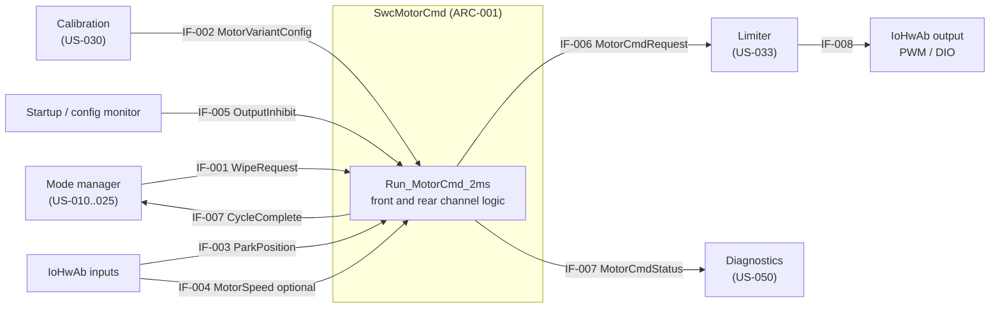
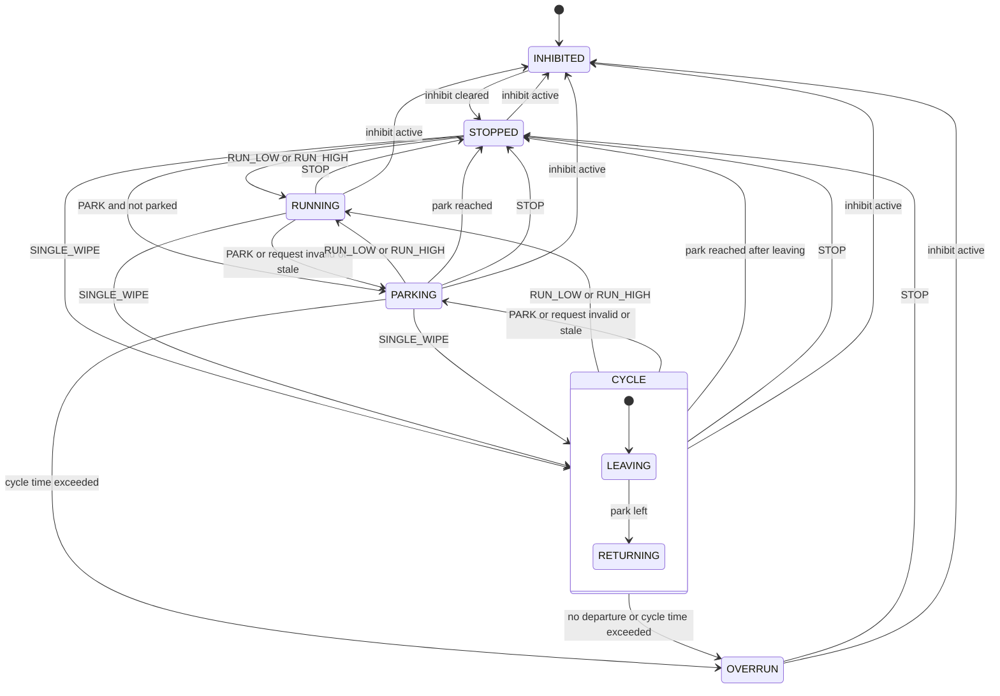
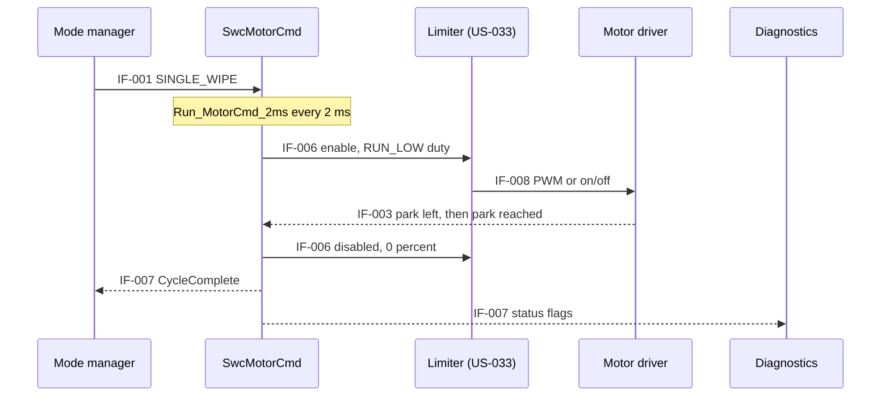

# US-032 (SCRUM-7): Motor Command Generation

| Field | Value |
|-------|-------|
| Story | SCRUM-7 / US-032 |
| PRD trace | Primary: PR-022. Supports: PR-003, PR-005, PR-020, PR-021, PR-041, PR-042, PR-043, PR-044, PR-045, PR-046, PR-060, PR-061, PR-062, PR-063 |
| Size | L |
| Status | Draft, revision 2 (review findings and user decisions applied) |

## 1. Story Summary

**Story:** As a controller, I want to generate motor commands through the driver, so that the wiper moves as requested.

**Acceptance criteria (as received)**
- AC1: Given a wipe request, when the control task runs, then the motor driver receives the corresponding command (PWM or equivalent).
- AC2: Given feedback is required by the control strategy, when it is available, then it is used in the command calculation.

**Decisions taken (user, 2026-10-27)**
- Driver OFF sends `PARK` to this component (issued by US-011).
- A lost or invalid request is treated as `PARK`.
- The limiter (US-033) sits after this component. The duty cap on the commanded duty is owned by US-032.
- A `CycleComplete` flag in the status output tells the upstream intermittent logic that a single wipe has finished.
- Without valid park feedback, the default time-based park behaviour applies (REQ-F-020).
- The command parameters this design needs are added to US-030.

**Out of scope (owned by other stories):**
- Torque, current and speed limit enforcement (US-033).
- Stall and overload detection (US-034).
- Variant parameter values and validation (US-030, US-031).
- Wipe-request decisions, intermittent timing, and mode priority (US-010 to US-013, US-021, US-025).
- Fault storage and reporting (US-050, US-053).
- Thermal derating (US-040 to US-043).

**Scope:** Front and rear motor channels (AGENTS.md). The rear channel is single speed.

**Valid feedback:** a feedback signal is valid when its value is not `INVALID`, it was received within its timeout (TBD), and it has not been marked implausible (REQ-F-024).

## 2. Requirements

Request modes (design-defined, see IF-001): `STOP`, `PARK`, `RUN_LOW`, `RUN_HIGH`, `SINGLE_WIPE`.

| ID | Requirement | Rationale | Verification | Trace |
|----|-------------|-----------|--------------|-------|
| REQ-F-001 | For each motor channel (front, rear), the software shall calculate and output one motor command in every execution of the 2 ms control task. | Deterministic command update tied to the 500 Hz task. | Test (TC-001) | AC1, PR-022, PR-020 |
| REQ-F-002 | The software shall map the requests `RUN_LOW` and `RUN_HIGH` to the duty defined for that step in the channel's variant parameter set. | The S/M/L variants have different parameters; labels alone must not set values. | Test (TC-002) | AC1, PR-022, PR-041 |
| REQ-F-003 | The software shall output each command as an enable flag plus a duty value (0 % to 100 %) on an abstract output interface that can be mapped to a PWM driver or an on/off driver, selected by the variant parameter set. | Supports "PWM or equivalent" without fixing the driver. | Test (TC-003) | AC1, PR-022 |
| REQ-F-004 | The delay from a change of the wipe request to the corresponding change of the command at the output interface (IF-006) shall not exceed one control-task period (2 ms); at the driver pin the added hardware delay is TBD. | A request must reach the driver at the next task execution. | Timing measurement (TC-001, TC-027) | AC1, PR-020 |
| REQ-F-005 | On `SINGLE_WIPE`, the software shall command the `RUN_LOW` duty until the wiper has left the park position and returned to it, then disable the output. | Intermittent wiping needs a motor-side single cycle; a cycle starting at park must not end at once. | Test (TC-004) | AC1, PR-003 |
| REQ-F-006 | On `PARK`, the software shall command the `RUN_LOW` duty until the park position is reached, then disable the output; if the wiper is already at park, the output shall stay disabled. | Safe stop with the wiper out of the field of view. | Test (TC-005) | AC1, PR-005 |
| REQ-F-007 | When park-position feedback is configured available and valid for a channel, the software shall use it to detect the park position for REQ-F-005 and REQ-F-006. | Feedback use required by AC2. | Test (TC-006) | AC2, PR-022 |
| REQ-F-008 | When speed feedback is configured available and valid for a channel, the software shall apply the closed-loop correction defined in the variant parameter set to the duty of the active step. | Feedback use required by AC2; the strategy is defined per variant. | Test (TC-007) | AC2, PR-022 |
| REQ-F-009 | When speed feedback configured as available is invalid or missing, the software shall calculate the command without the correction (open loop) and shall set `FeedbackDegraded` for that channel. | Avoids a wrong command from bad feedback while keeping the wiper working. | Fault injection (TC-008) | AC2, PR-062 |
| REQ-F-010 | When no feedback is configured for a channel, the software shall calculate the command open loop and shall not set `FeedbackDegraded`. | Variants and hardware may have no feedback (PRD open question 5). | Test (TC-009) | AC2, PR-022 |
| REQ-F-011 | While the inhibit input of a channel is active, the software shall keep that channel disabled at 0 % and ignore its wipe requests; after the inhibit clears, the channel shall start from `STOPPED`. | No unintended motion at startup, reset, or invalid configuration. US-031 allows "disabled or restricted"; restricted operation is not defined, so this design disables. | Test (TC-010) | PR-063, PR-046 |
| REQ-F-012 | When a wipe request has an undefined value or a mode not allowed for the channel, the software shall treat it as `PARK` and set `RequestInvalid`. | A defined, safe reaction to a corrupt request (decision 2). | Fault injection (TC-011) | PR-062 |
| REQ-F-013 | A change of request, state, or fault of one channel shall not change the command of the other channel. | A front fault must not stop the rear wiper, and the reverse. | Test (TC-012) | PR-022 |
| REQ-F-014 | The software shall output, per channel, a status containing the channel state, `FeedbackDegraded`, `RequestInvalid`, and `CycleOverrun`, updated every execution of the control task. | Lets diagnostics (US-050) record faults. | Test (TC-013) | PR-060 |
| REQ-F-015 | If the park position is not reached within the maximum wipe-cycle time (TBD) after a `PARK` or `SINGLE_WIPE` command started, the software shall disable the output, enter `OVERRUN`, and set `CycleOverrun`. | Stops a motor that runs on when park feedback is stuck or the wiper is blocked. | Fault injection (TC-017) | PR-044, PR-045 |
| REQ-F-016 | On `STOP`, the software shall disable the output at 0 % in the same execution, from any state except `INHIBITED`. | Immediate stop on an explicit request; a driver OFF uses `PARK` instead. | Test (TC-019) | PR-005, PR-063 |
| REQ-F-017 | For an on/off driver, the software shall switch the output on when the enable flag is true and the duty is above 0 %, and off otherwise (Assumption; mapping of the `RUN_HIGH` step for relay drivers is TBD). | The duty-to-on/off rule must be defined to be testable. | Test (TC-003) | AC1, PR-022 |
| REQ-F-018 | If the wiper has not left the park position within the park departure time (TBD) after a `SINGLE_WIPE` started, the software shall disable the output, enter `OVERRUN`, and set `CycleOverrun`. | Detects a stalled or blocked wiper at the start of a cycle. | Fault injection (TC-020) | PR-044, PR-045 |
| REQ-F-019 | The software shall limit the corrected duty to the range 0 % to the maximum duty of the active step defined in the variant parameter set. | Caps the closed-loop correction (decision 3); the envelope limits stay with US-033. | Test (TC-021) | PR-042, PR-043 |
| REQ-F-020 | When park feedback is not configured, or is configured but not valid, `PARK` and `SINGLE_WIPE` shall run the `RUN_LOW` duty for the calibrated park cycle duration (TBD) and then disable the output; if configured but not valid, `FeedbackDegraded` shall be set. | A defined exit without park feedback (decision 6). Time-based stopping can leave the wiper off park, which is why it is a default and not a preferred behaviour. | Test (TC-022) | AC2, PR-062 |
| REQ-F-021 | When a wipe request is not refreshed within the request timeout (TBD), the software shall treat it as `PARK` and set `RequestInvalid`. | A defined, safe reaction to a lost request (decision 2). | Fault injection (TC-023) | PR-062 |
| REQ-F-022 | The status shall contain the flag `CycleComplete` per channel; it shall be set when a `SINGLE_WIPE` cycle completes and held until the next change of the wipe request for that channel. | Lets the intermittent logic (US-013, US-021) time the next cycle (decision 4). | Test (TC-024) | PR-003 |
| REQ-F-023 | `RequestInvalid` and `FeedbackDegraded` shall clear when the cause is no longer present (valid request received; feedback valid again). `CycleOverrun` shall stay set, with the channel in `OVERRUN` and disabled, until a `STOP` request or an inhibit occurs; requests other than `STOP` shall be ignored in `OVERRUN`. | A defined recovery condition per fault (PR-061). A retry limit is TBD (US-034, US-050). | Test (TC-025) | PR-061 |
| REQ-F-024 | While a channel runs `RUN_LOW` or `RUN_HIGH` and park feedback is valid, the software shall mark the park feedback implausible and set `FeedbackDegraded` if the park signal has not changed state within the plausibility time (TBD). | Detects a stuck park signal that would end parking with the wiper still in view. | Fault injection (TC-026) | PR-060, PR-062 |
| REQ-N-001 | The command runnable shall complete within an execution-time share of the 2 ms task period (TBD, set by US-002). | Keeps the 500 Hz deadline. | WCET analysis (TC-014) | PR-021 |
| REQ-N-002 | Before initialization is complete and after any reset, the command output shall be disabled at 0 %. | No motion before the software is ready. | HIL (TC-015) | PR-063 |
| REQ-N-003 | The duty resolution shall be TBD (set by the selected driver and timer). | The resolution depends on hardware not yet selected. | Test (TC-016) | PR-022 |

**Gaps against the PRD**
- PR-022 requires a "compatible motor driver". Compatibility cannot be verified until the driver is selected (soft dependency).
- PR-022 says feedback is used "where required by the selected control strategy". The strategy is not defined (PRD open question 5), so REQ-F-007, REQ-F-008 and REQ-F-024 are conditional on configuration.
- `SINGLE_WIPE`, `OVERRUN`, `CycleComplete` and the plausibility check are design concepts, not in the PRD. They are derived from PR-003, PR-005, PR-044 and PR-045 and need agreement from the owners of US-011, US-013 and US-021.

## 3. Dependencies

| Dependency | Type | Needed for | Status |
|------------|------|------------|--------|
| US-030 Motor variant parameter sets | Hard | Duty per step, maximum duty, output type, feedback flags, correction and timing parameters (IF-002). Requested in the US-030 acceptance criteria. | Not started; stub in tests |
| Motor driver selection | Soft | Output mapping, PWM frequency, duty resolution, driver default state | Open |
| US-001 Periodic 2 ms control task | Soft (additional, not in the story list) | Execution of the runnable | Stub scheduler in tests |
| US-011, US-012, US-013, US-021, US-025 | Soft (additional) | Source of wipe requests (IF-001); US-011 issues `PARK` on driver OFF; US-013 and US-021 consume `CycleComplete` | Stub in tests |
| US-031 / US-052 | Soft (additional) | Source of the per-channel inhibit (IF-005) | Stub in tests |
| US-050 | Soft | Consumer of the status (IF-007) | Stub in tests |
| Limiter interface (IF-006), owned with US-033 | Soft (interface only) | Consumer of the command. US-033 is hard-dependent on US-032, not the reverse. | Stub in tests |

The additional soft dependencies are not in [user_stories.md](../../user_stories.md); only the US-030 entry was updated there.

## 4. Interfaces

| ID | Signal / API | Direction | Source | Destination | Type, range, unit | Cycle / timeout | Invalid value |
|----|--------------|-----------|--------|-------------|-------------------|-----------------|---------------|
| IF-001 | WipeRequest (one per channel) | In | Mode manager (US-010 to US-025) | SwcMotorCmd | Enum: `STOP`, `PARK`, `RUN_LOW`, `RUN_HIGH`, `SINGLE_WIPE`. Rear channel allows `STOP`, `PARK`, `RUN_LOW`, `SINGLE_WIPE`. | 2 ms / timeout TBD | Undefined value: treated as `PARK` |
| IF-002 | MotorVariantConfig (per channel), parameters requested from US-030 | In | Calibration (US-030) | SwcMotorCmd | Variant S/M/L; duty for `RUN_LOW` and `RUN_HIGH` (%, TBD); maximum duty per step (%, TBD); output type (PWM or on/off); park and speed feedback availability flags; speed-correction parameters (TBD); timing parameters in ms: park cycle duration, park departure time, maximum wipe-cycle time, plausibility time (all TBD) | Read at init | Missing or invalid: channel stays inhibited (US-031) |
| IF-003 | ParkPosition (per channel) | In | IoHwAb | SwcMotorCmd | Enum: `PARKED`, `NOT_PARKED`, `INVALID`; debounce TBD | 2 ms / timeout TBD | `INVALID` |
| IF-004 | MotorSpeed (per channel, optional) | In | IoHwAb | SwcMotorCmd | Float, 0 Hz to TBD (wipe cycles per second) | 2 ms / timeout TBD | `INVALID` flag |
| IF-005 | OutputInhibit (per channel) | In | Startup / configuration monitor (US-031, US-052) | SwcMotorCmd | Boolean | 2 ms | Active (inhibit) |
| IF-006 | MotorCmdRequest (per channel) | Out | SwcMotorCmd | Limiter (US-033), then IoHwAb | Enable: boolean; duty: 0 % to 100 %, resolution TBD | 2 ms | Enable false, 0 % |
| IF-007 | MotorCmdStatus (per channel) | Out | SwcMotorCmd | Mode manager (`CycleComplete`) and Diagnostics (US-050) | Struct: state enum, `FeedbackDegraded`, `RequestInvalid`, `CycleOverrun`, `CycleComplete` (booleans) | 2 ms | All fault flags set, `CycleComplete` false |
| IF-008 | Driver output (PWM or digital) | Out | IoHwAb | Motor driver hardware | Signal names, PWM frequency: TBD | Per driver | Disabled |

## 5. Design

### 5.1 Component structure

| ID | Element | Description |
|----|---------|-------------|
| ARC-001 | SwcMotorCmd | AUTOSAR SWC with one runnable `Run_MotorCmd_2ms` (period 2 ms, in the control task). It holds one instance of the channel logic per motor (front, rear). |
| ARC-002 | Channel state machine | Per channel; states in section 5.2. |
| ARC-003 | Command calculator | Looks up duty for the active step in IF-002, applies the closed-loop correction when speed feedback is valid, limits the result to the maximum duty (REQ-F-019), and outputs IF-006. |
| ARC-004 | Output mapping | Maps IF-006 to PWM or on/off according to IF-002; implemented in IoHwAb/MCAL (TBD by driver selection). |
| ARC-005 | Feedback monitor | Applies timeout and plausibility checks to IF-003 and IF-004 and provides the "valid" flags used by the state machine and calculator. |

Ports of SwcMotorCmd: R-ports IF-001, IF-002, IF-003, IF-004, IF-005; P-ports IF-006, IF-007.

### 5.2 Channel behaviour

| State | Output |
|-------|--------|
| INHIBITED | Disabled, 0 % |
| STOPPED | Disabled, 0 % |
| RUNNING | Duty of the active step |
| CYCLE | `RUN_LOW` duty until the wiper has left and returned to park |
| PARKING | `RUN_LOW` duty until park reached |
| OVERRUN | Disabled, latched until `STOP` or inhibit |

With park feedback not configured or not valid, "park reached" and "park left" are replaced by the calibrated park cycle duration (REQ-F-020). `CycleComplete` is set on the transition from `CYCLE` to `STOPPED` by "park reached after leaving".

### 5.3 Command sequence

### 5.4 Error handling

| Condition | Reaction |
|-----------|----------|
| Inhibit active | Disabled, state INHIBITED (REQ-F-011) |
| Request undefined or mode not allowed | Treated as `PARK`, `RequestInvalid` set (REQ-F-012) |
| Request not refreshed in time | Treated as `PARK`, `RequestInvalid` set (REQ-F-021) |
| Speed feedback invalid | Open loop, `FeedbackDegraded` set (REQ-F-009) |
| Park feedback invalid or not configured | Time-based park cycle (REQ-F-020) |
| Park signal implausible | Park feedback treated as invalid, `FeedbackDegraded` set (REQ-F-024) |
| Park not left or not reached in time | Disabled, `OVERRUN`, `CycleOverrun` set (REQ-F-015, REQ-F-018) |

### 5.5 Design decisions

| Decision | Alternatives considered | Reason |
|----------|-------------------------|--------|
| Abstract output (enable + duty), mapped per variant | Fix the SWC to PWM only | Driver is not selected; keeps the SWC reusable across S/M/L and for the on/off alternative. |
| Command generation separate from limiting; limiter after this component (user decision) | Limit inside this SWC | Matches the story split; the limiter can be tested on its own. |
| Duty cap on the corrected duty owned by this story | Cap in US-033 only | The correction is applied here, so the cap must be applied here; US-033 still limits torque, current and speed. |
| Open-loop baseline with optional park and speed feedback | Closed loop mandatory | Feedback availability is open (PRD open question 5). |
| Motor-side single wipe cycle (`SINGLE_WIPE`) with `CycleComplete` | Upper layer runs and stops the motor | Needs park feedback close to the motor output; the interval timing stays upstream. |
| Latched `OVERRUN` state cleared by `STOP` or inhibit | Auto-restart on the next request | Avoids repeatedly driving a blocked wiper; a retry limit is left to US-034 and US-050. |
| No supply-voltage compensation in the baseline | Scale duty by supply voltage | Need depends on supply voltage and the driver (open item 4). |

## 6. Safety Considerations

No ASIL is assigned here; items are flagged for the HARA.

| ID | Hazard / fault | Detection | Reaction / safe state | Flag for HARA | Verified by |
|----|----------------|-----------|-----------------------|---------------|-------------|
| SAF-001 | Unintended motor activation (command active while `STOP`, inhibited, or before init) | State machine rules; default-disabled output | Output disabled at 0 % (REQ-F-016, REQ-F-011, REQ-N-002) | Yes: unintended wiping | TC-010, TC-015, TC-019 |
| SAF-002 | Loss of wiping because the request is lost or corrupt | Request timeout / validity check | Park, then stop (REQ-F-012, REQ-F-021); user decision, HARA to confirm against holding the last speed | Yes: loss of wiping in rain | TC-011, TC-023 |
| SAF-003 | Wrong closed-loop correction from faulty speed feedback | Feedback validity check | Open loop, `FeedbackDegraded` (REQ-F-009) | Yes: wrong speed | TC-007, TC-008 |
| SAF-004 | Motor runs on because park feedback is stuck or the wiper is blocked | Maximum wipe-cycle time; departure time | Output disabled, latched `OVERRUN` (REQ-F-015, REQ-F-018, REQ-F-023) | Yes: blocked wiper, overheating | TC-017, TC-020, TC-025 |
| SAF-005 | Command above the approved envelope reaches the driver | Duty cap here; envelope limiter in US-033 | Corrected duty limited to the step maximum (REQ-F-019); limiting by US-033 | Yes: motor overload | TC-002, TC-018, TC-021 |
| SAF-006 | Wiper stopped away from park (explicit `STOP`, inhibit, or time-based park) leaves it in the field of view | Not detectable without park feedback | Driver OFF issues `PARK`, not `STOP` (decision 1); inhibit disables immediately; time-based park is a documented default (REQ-F-020) | Yes: wiper in the field of view | TC-019, TC-022 |
| SAF-007 | Stuck or false `PARKED` ends parking with the wiper in view | Plausibility check of the park signal | Park feedback marked implausible, `FeedbackDegraded`, time-based park (REQ-F-024, REQ-F-020) | Yes: wiper in the field of view | TC-026 |

## 7. Verification

Independent test approach: the runnable is tested in MIL/SIL with stubs for the scheduler, request source, variant parameters, feedback, inhibit, limiter, and driver. HIL tests use a simulated driver and motor model.

| ID | Linked requirement(s) | Preconditions | Steps | Expected result | Level |
|----|-----------------------|---------------|-------|-----------------|-------|
| TC-001 | REQ-F-001, REQ-F-004 | Runnable scheduled every 2 ms; channel `STOPPED` | Change request to `RUN_LOW`; observe IF-006 each period | A command is output every execution; the new command appears at the next execution (within 2 ms) | SIL |
| TC-002 | REQ-F-002, SAF-005, SAF-001 | Variant S, M, and L parameter sets, front and rear | Apply `RUN_LOW` and `RUN_HIGH` | Duty equals the configured value for that step; the duty never exceeds the configured maximum | SIL |
| TC-003 | REQ-F-003, REQ-F-017 | PWM-type and on/off-type configurations | Apply `RUN_LOW`, `STOP`, and a request with duty 0 % | PWM configuration outputs enable + duty; on/off configuration is on only when enable is true and duty above 0 % | SIL |
| TC-004 | REQ-F-005 | Park feedback valid; wiper at park | Request `SINGLE_WIPE`; simulate leaving and returning to park | Output at `RUN_LOW` duty until the wiper has left and returned; disabled after return; it does not end at the start | SIL |
| TC-005 | REQ-F-006 | Park feedback valid | Request `PARK` when not parked, then when parked | Runs at `RUN_LOW` duty until parked, then disabled; stays disabled if already parked | SIL |
| TC-006 | REQ-F-007 | Park feedback configured and valid | Set `PARKED` during `PARKING` | Output disabled in the execution after the debounced `PARKED` is seen | SIL |
| TC-007 | REQ-F-008 | Speed feedback configured and valid; correction parameters from stub | Feed a speed below and above the set speed | Duty is corrected in the direction defined by the parameters | SIL |
| TC-008 | REQ-F-009 | Speed feedback configured | Set `INVALID`; stop updating the signal until its timeout | Open-loop command in both cases; `FeedbackDegraded` set | SIL |
| TC-009 | REQ-F-010 | No feedback configured | Run `RUN_LOW`, `RUN_HIGH`, `STOP` | Open-loop command; `FeedbackDegraded` never set | SIL |
| TC-010 | REQ-F-011, SAF-001 | Both channels `RUNNING` | Activate inhibit on the front channel only with a `RUN_HIGH` request present; then clear it | Front output disabled at once and its request ignored; rear unchanged; after clear, front state `STOPPED` | SIL |
| TC-011 | REQ-F-012, SAF-002 | Channel `RUNNING` | Send an undefined value; send `RUN_HIGH` on the rear channel | Each case acts as `PARK`; `RequestInvalid` set | SIL |
| TC-012 | REQ-F-013 | Both channels `RUNNING` | Inject a request, feedback, or timeout fault on one channel | The other channel's command is unchanged | SIL |
| TC-013 | REQ-F-014 | Any state | Drive each state and fault condition | Status fields match the state and flags every execution | SIL |
| TC-014 | REQ-N-001 | Target hardware or instruction-set simulator | Measure worst-case runnable execution time | Within the budget set by US-002 | HIL |
| TC-015 | REQ-N-002, SAF-001 | Target hardware | Power up and reset with probes on the driver input | Output disabled until initialization completes | HIL |
| TC-016 | REQ-N-003 | Selected driver and timer | Sweep duty commands | Resolution as specified (value TBD) | HIL |
| TC-017 | REQ-F-015, SAF-004 | Park feedback stuck at `NOT_PARKED` | Request `PARK` and `SINGLE_WIPE` | Output disabled at the maximum cycle time; `CycleOverrun` set; state `OVERRUN` | SIL |
| TC-018 | SAF-005 | Limiter stub that reduces duty | Run `RUN_HIGH` through IF-006 to the driver stub | The driver stub receives the limiter's reduced duty (hand-off check; limiter behaviour is tested in US-033) | SIL |
| TC-019 | REQ-F-016, SAF-001, SAF-006 | Channel in each state | Send `STOP` in `RUNNING`, `CYCLE`, `PARKING`, `OVERRUN` | Output disabled in the same execution in each state | SIL |
| TC-020 | REQ-F-018, SAF-004 | Wiper at park, stuck | Request `SINGLE_WIPE` with the park signal unchanged | Output disabled at the departure time; `CycleOverrun` set | SIL |
| TC-021 | REQ-F-019, SAF-005 | Speed correction that would exceed the maximum and go below 0 % | Apply `RUN_HIGH` with extreme speed feedback | Duty limited to 0 % and to the maximum | SIL |
| TC-022 | REQ-F-020, SAF-006 | Park feedback not configured; then configured but `INVALID` | Request `PARK` and `SINGLE_WIPE` | Runs for the calibrated park cycle duration, then disabled; `FeedbackDegraded` set only in the second case | SIL |
| TC-023 | REQ-F-021, SAF-002 | Channel `RUNNING` | Stop refreshing the request until the timeout | Acts as `PARK`; `RequestInvalid` set | SIL |
| TC-024 | REQ-F-022 | Park feedback valid | Complete a `SINGLE_WIPE`; then change the request | `CycleComplete` set on completion, held, cleared on the next request change | SIL |
| TC-025 | REQ-F-023, SAF-004 | Channel in `OVERRUN`, then `RequestInvalid` and `FeedbackDegraded` set | Send `RUN_LOW`; send `STOP`; remove the causes of the other flags | `RUN_LOW` ignored in `OVERRUN`; `STOP` exits it; the other two flags clear when their causes clear | SIL |
| TC-026 | REQ-F-024, SAF-007 | Park feedback valid | Hold the park signal at `PARKED`, then at `NOT_PARKED`, during `RUN_LOW` beyond the plausibility time | `FeedbackDegraded` set; park feedback treated as invalid | SIL |
| TC-027 | REQ-F-004 | Target hardware | Change the request and probe the driver pin | Pin change appears within one task period plus the hardware delay (value TBD) | HIL |

## 8. Traceability

| Story AC | Requirement | Design element | Interface | Safety item | Test case |
|----------|-------------|----------------|-----------|-------------|-----------|
| AC1 | REQ-F-001, REQ-F-004 | ARC-001 | IF-001, IF-006 | | TC-001, TC-027 |
| AC1 | REQ-F-002 | ARC-003 | IF-001, IF-002, IF-006 | SAF-001, SAF-005 | TC-002 |
| AC1 | REQ-F-003, REQ-F-017 | ARC-004 | IF-006, IF-008 | | TC-003 |
| AC1 | REQ-F-005 | ARC-002 | IF-001, IF-003 | | TC-004 |
| AC1 | REQ-F-006 | ARC-002 | IF-001, IF-003 | | TC-005 |
| AC2 | REQ-F-007 | ARC-002, ARC-005 | IF-003 | | TC-006 |
| AC2 | REQ-F-008 | ARC-003 | IF-004, IF-002 | SAF-003 | TC-007 |
| AC2 | REQ-F-009 | ARC-003, ARC-005 | IF-004, IF-007 | SAF-003 | TC-008 |
| AC2 | REQ-F-010 | ARC-003 | IF-002 | | TC-009 |
| AC2 | REQ-F-020 | ARC-002, ARC-005 | IF-002, IF-003, IF-007 | SAF-006 | TC-022 |
| Derived | REQ-F-011 | ARC-002 | IF-005 | SAF-001 | TC-010 |
| Derived | REQ-F-012 | ARC-002 | IF-001, IF-007 | SAF-002 | TC-011 |
| Derived | REQ-F-013 | ARC-001 | IF-006 | | TC-012 |
| Derived | REQ-F-014 | ARC-001 | IF-007 | | TC-013 |
| Derived | REQ-F-015 | ARC-002 | IF-003, IF-007 | SAF-004 | TC-017 |
| Derived | REQ-F-016 | ARC-002 | IF-001, IF-006 | SAF-001, SAF-006 | TC-019 |
| Derived | REQ-F-018 | ARC-002 | IF-003, IF-007 | SAF-004 | TC-020 |
| Derived | REQ-F-019 | ARC-003 | IF-002, IF-006 | SAF-005 | TC-021 |
| Derived | REQ-F-021 | ARC-002 | IF-001, IF-007 | SAF-002 | TC-023 |
| Derived | REQ-F-022 | ARC-002 | IF-007 | | TC-024 |
| Derived | REQ-F-023 | ARC-002 | IF-007 | SAF-004 | TC-025 |
| Derived | REQ-F-024 | ARC-005 | IF-003, IF-007 | SAF-007 | TC-026 |
| Derived | REQ-N-001 | ARC-001 | | | TC-014 |
| Derived | REQ-N-002 | ARC-004 | IF-008 | SAF-001 | TC-015 |
| Derived | REQ-N-003 | ARC-004 | IF-006, IF-008 | | TC-016 |
| AC1 | Limiter hand-off | ARC-001 | IF-006 | SAF-005 | TC-018 |

## 9. Open Items

| # | Type | Description | Owner | Affects |
|---|------|-------------|-------|---------|
| 1 | Assumption | The 500 Hz requirement applies to the control task, so the runnable executes every 2 ms (PRD open question 3). | System architect | REQ-F-001, REQ-F-004 |
| 2 | Assumption | One motor per channel (front, rear); rear is single speed with intermittent (AGENTS.md defaults). | OEM | REQ-F-002, IF-001 |
| 3 | Assumption | The park position is available as a digital feedback signal from each wiper motor. Without it, REQ-F-020 applies. | Hardware lead | REQ-F-005 to REQ-F-007, REQ-F-020, REQ-F-024 |
| 4 | Assumption | Passenger-car electrical system, nominal 12 V (PRD open question 1); no supply-voltage compensation in the baseline. Confirm whether compensation is needed. | OEM | Design decision in 5.5 |
| 5 | Assumption | Output interface is enable + duty; for an on/off driver the output is on when enable is true and duty is above 0 % (REQ-F-017). The physical driver is selected later. | Hardware lead | REQ-F-003, REQ-F-017, IF-008 |
| 6 | Assumption | `SINGLE_WIPE` handles one motor-side cycle; the interval between cycles is decided upstream. Needs agreement from the owners of US-011, US-013 and US-021. | Story owners | REQ-F-005, REQ-F-022 |
| 7 | Assumption (default kept by user) | Without valid park feedback, `PARK` and `SINGLE_WIPE` run for a calibrated park cycle duration and then stop; the wiper may stop off park. | System architect | REQ-F-020, SAF-006 |
| 8 | TBD | Request timeout, park departure time, maximum wipe-cycle time, plausibility time, park-feedback debounce and timeout, IF-004 timeout and range. | System architect | REQ-F-012, REQ-F-015, REQ-F-018, REQ-F-021, REQ-F-024, IF-003, IF-004 |
| 9 | TBD | Duty per step, maximum duty per step, park cycle duration, output type per variant (values come from US-030, parameters requested in its acceptance criteria). | US-030 owner | REQ-F-002, REQ-F-019, REQ-F-020, IF-002 |
| 10 | TBD | PWM frequency, duty resolution, driver default state, driver interface and signal names, relay mapping of the `RUN_HIGH` step, hardware delay at the driver pin. | Hardware lead | REQ-F-004, REQ-F-017, REQ-N-002, REQ-N-003, IF-006, IF-008 |
| 11 | TBD | Speed-feedback availability, range, and closed-loop correction parameters (PRD open question 5). | Calibration / US-030 | REQ-F-008, IF-002, IF-004 |
| 12 | TBD | Execution-time share of the runnable. | US-002 | REQ-N-001 |
| 13 | TBD | Retry limit after `CycleOverrun`. | US-034, US-050 | REQ-F-023 |
| 14 | Decision (user), HARA to confirm | A lost or invalid request is treated as `PARK`, not held at the last speed. | Safety engineer | REQ-F-012, REQ-F-021, SAF-002 |
| 15 | Decision (user) | Driver OFF issues `PARK`; `STOP` is an explicit stop. US-011 must implement this. | US-011 owner | REQ-F-006, REQ-F-016, SAF-006 |
| 16 | Decision (user) | The limiter sits after this component; this story owns the duty cap. | US-033 owner | REQ-F-019, IF-006 |
| 17 | Decision (user) | `CycleComplete` in IF-007 is the end-of-cycle signal for the interval logic. US-013 and US-021 must consume it. | US-013, US-021 owners | REQ-F-022, IF-007 |
| 18 | Action | US-030 acceptance criteria updated in [user_stories.md](../../user_stories.md). The US-030 Jira story does not exist yet. | Story owner | IF-002 |
| 19 | Question | Where does thermal derating (US-040 to US-043) enter: in the limiter stage or before this component? | US-040 to US-043 owners | IF-006 |
| 20 | Question | Add the additional soft dependencies of US-032 to [user_stories.md](../../user_stories.md)? | Story owner | Section 3 |
