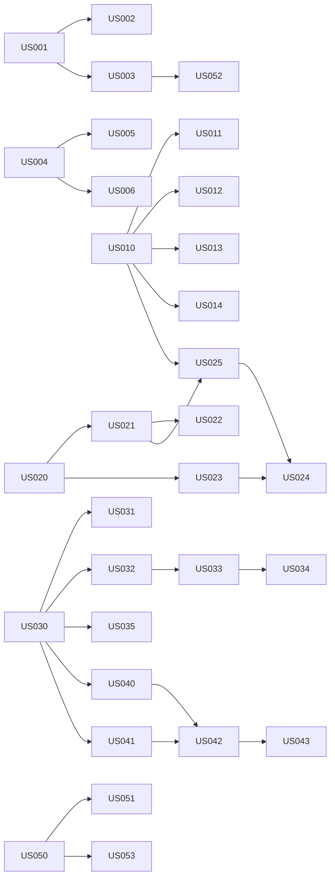

# User Stories: Rain-Adaptive Wiper Control System

**Source:** [wiper_control_system_product_requirements.md](wiper_control_system_product_requirements.md) (PRD v1.0)
**Purpose:** Backlog for per-story requirement analysis. Each story is independently testable, sized S/M/L, and lists its dependencies.

## 1. Conventions

- Story ID: `US-nnn`. Requirement IDs `PR-nnn` refer to the PRD. Do not reuse IDs.
- Size (relative effort and uncertainty, not duration):
  - **S**: one behaviour, no new hardware or interface dependency.
  - **M**: several behaviours, or one external dependency (hardware, calibration, vehicle interface).
  - **L**: multiple components, feedback hardware, or safety analysis involved.
- Values marked `TBD` come from the PRD open questions (section 12) and must be resolved during that story's requirement analysis. No values are invented here.
- Test independence: each story is verified with stubs/simulated inputs so it does not need other stories to be finished. Dependencies describe build and integration order, not test blocking.
- Dependency types: **Hard** = needed to build or test the story; **Soft** = needed only for integration or a final value.

## 2. Story Index

| ID | Title | Epic | Size | PRD requirements | Hard dependencies |
|----|-------|------|------|------------------|-------------------|
| US-001 | Periodic 2 ms control task | A Platform | M | PR-020, PR-027 | None |
| US-002 | Execution-time budget and task isolation | A Platform | M | PR-021, PR-025, PR-034 | US-001 |
| US-003 | Watchdog supervision and overrun handling | A Platform | M | PR-026 | US-001 |
| US-004 | RAM and flash budget | A Platform | S | PR-030, PR-031, PR-032 | None |
| US-005 | Persistent settings integrity | A Platform | M | PR-033 | US-004 |
| US-006 | MCU selection | A Platform | M | PR-023, PR-024 | US-004 (soft: US-002, US-033) |
| US-010 | Driver input acquisition and filtering | B Driver input | M | PR-007 | None |
| US-011 | Driver OFF mode and input priority | B Driver input | S | PR-001, PR-005 | US-010 |
| US-012 | Continuous wipe mode | B Driver input | S | PR-002 | US-010 |
| US-013 | Intermittent mode with configurable interval | B Driver input | M | PR-003 | US-010 |
| US-014 | Invalid driver input handling | B Driver input | M | PR-006 | US-010 |
| US-020 | Rain-sensor acquisition and intensity level | C Rain sensing | M | PR-010 | None |
| US-021 | Rain-intensity to wipe mapping | C Rain sensing | M | PR-011, PR-015 | US-020 |
| US-022 | Hysteresis and filtering of rain mapping | C Rain sensing | M | PR-012 | US-021 |
| US-023 | Rain-sensor validity detection | C Rain sensing | M | PR-013 | US-020 |
| US-024 | Sensor-invalid fallback behaviour | C Rain sensing | M | PR-014 | US-023, US-025 |
| US-025 | Automatic mode selection | C Rain sensing | S | PR-004 | US-010, US-021 |
| US-030 | Motor variant parameter sets (S/M/L) | D Motor | M | PR-040, PR-041 | None |
| US-031 | Startup configuration validation | D Motor | S | PR-046 | US-030 |
| US-032 | Motor command generation | D Motor | L | PR-022 | US-030 |
| US-033 | Torque, current and speed limit enforcement | D Motor | L | PR-042, PR-043 | US-030, US-032 |
| US-034 | Stall and overload detection and response | D Motor | L | PR-044, PR-045 | US-032, US-033 |
| US-035 | Motor and linkage sizing verification | D Motor | M | PR-047 | US-030 |
| US-040 | Duty-cycle and eight-hour operation policy | E Thermal | L | PR-050, PR-051 | US-030 |
| US-041 | Motor and driver temperature monitoring | E Thermal | L | PR-052, PR-053 | US-030 |
| US-042 | Thermal warning, derating and shutdown | E Thermal | M | PR-054, PR-055 | US-041, US-040 |
| US-043 | Thermal protection recovery | E Thermal | S | PR-056 | US-042 |
| US-050 | Fault catalogue and recording | F Diagnostics | M | PR-060, PR-061 | None (soft: all fault-producing stories) |
| US-051 | Documented fallback state | F Diagnostics | M | PR-062 | US-050 |
| US-052 | Safe startup, reset and brownout | F Diagnostics | M | PR-063 | US-003 |
| US-053 | Diagnostic reporting over the vehicle interface | F Diagnostics | M | PR-064 | US-050 (soft: vehicle interface decision) |
| US-060 | Verification traceability baseline | G Verification | S | All PR-nnn | None (soft: all stories) |

## 3. Dependency Overview

## 4. Epic A: Platform and Real-Time Execution

### US-001 Periodic 2 ms control task (M)
**Requirements:** PR-020, PR-027
**Story:** As a control engineer, I want the sensing/control task to run every 2 ms, so that the controller meets its 500 Hz execution target.
**Dependencies:** None.
**Acceptance criteria:**
- Given the controller is running, when the task period is measured over a defined observation window, then the period equals 2 ms within a tolerance `TBD`.
- Given the task runs, when execution time is measured, then it is recorded and available as a diagnostic value.
- Given the 500 Hz scope is confirmed (PRD open question 3), when the scope differs from "control task", then this story's scope is updated before implementation.
**Independent test:** Run the task on target or simulator with no sensor or motor attached; measure period and execution time with a timer/trace tool.
**Analysis inputs:** Scope of "500 Hz"; jitter tolerance; scheduler/OS choice.

### US-002 Execution-time budget and task isolation (M)
**Requirements:** PR-021, PR-025, PR-034
**Story:** As a control engineer, I want a worst-case execution time (WCET) budget and isolation from lower-priority work, so that the 2 ms deadline is never missed.
**Dependencies:** Hard: US-001.
**Acceptance criteria:**
- Given the defined worst-case workload, when the task is analysed and stress-tested, then execution completes within 2 ms minus an engineering-approved margin `TBD`.
- Given a lower-priority workload is running, when it executes at its maximum load, then no deadline miss occurs in the control task.
- Given an optional workload exceeds its resource allowance, when it overruns, then the control task is unaffected.
**Independent test:** Inject synthetic low-priority load and measure deadline misses.
**Analysis inputs:** Worst-case workload definition; margin; hosted application (PRD open question 9).

### US-003 Watchdog supervision and overrun handling (M)
**Requirements:** PR-026
**Story:** As a safety engineer, I want watchdog supervision with defined behaviour on overrun, lockup or reset, so that software faults lead to a known state.
**Dependencies:** Hard: US-001.
**Acceptance criteria:**
- Given the control task overruns or locks up, when the watchdog timeout elapses, then the defined reaction occurs (reset or safe state, `TBD`).
- Given the system resets, when it restarts, then the reset cause is recorded.
- Given normal operation, when the control task runs on time, then the watchdog does not trigger.
**Independent test:** Fault-inject a task stall and an overrun; observe reaction and recorded cause.
**Analysis inputs:** Watchdog type and timeout; safe state definition; reset-cause availability on the chosen MCU.

### US-004 RAM and flash budget (S)
**Requirements:** PR-030, PR-031, PR-032
**Story:** As a software lead, I want a RAM and flash budget, so that the application stays within memory limits and handles exhaustion safely.
**Dependencies:** None.
**Acceptance criteria:**
- Given the build output, when static analysis runs, then code, stack, heap (if used), calibration, diagnostics and persistent-settings usage are each reported against their budget.
- Given memory use exceeds a budget or an allocation fails, when this is detected, then the system takes the defined safe response (`TBD`).
**Independent test:** Static analysis report plus a simulated allocation failure.
**Analysis inputs:** Memory sizes of the candidate MCU(s); safe response definition.

### US-005 Persistent settings integrity (M)
**Requirements:** PR-033
**Story:** As a driver, I want my stored settings to remain valid, so that the wipers behave predictably after restarts.
**Dependencies:** Hard: US-004.
**Acceptance criteria:**
- Given stored settings, when they are read, then an integrity check (mechanism `TBD`) and version check are performed.
- Given settings are corrupted or the version is unknown, when the system starts, then safe defaults are used and a fault is recorded.
**Independent test:** Corrupt and version-mismatch the stored data in a test fixture.
**Analysis inputs:** Which settings persist (for example interval, sensitivity); integrity mechanism; defaults.

### US-006 MCU selection (M)
**Requirements:** PR-023, PR-024
**Story:** As a system architect, I want a documented MCU selection against the PRD criteria (section 9), so that the chosen Renesas or TI part meets the application needs.
**Dependencies:** Hard: US-004. Soft: US-002, US-033 (peripheral and timing needs).
**Acceptance criteria:**
- Given the candidate parts, when each is scored against PRD section 9 criteria, then the comparison is documented with the selection rationale.
- Given the selected part, when reviewed, then CPU, RAM, flash, timer/PWM, ADC, communication, watchdog and safety features are shown to satisfy the requirements.
**Independent test:** Design review against the criteria checklist.
**Analysis inputs:** Peripheral needs; environmental range; safety allocation (PRD open question 11).

## 5. Epic B: Driver Input and Modes

### US-010 Driver input acquisition and filtering (M)
**Requirements:** PR-007
**Story:** As a driver, I want my switch selection read reliably, so that noise does not change the wiper behaviour.
**Dependencies:** None.
**Acceptance criteria:**
- Given a changing driver input, when contact bounce or noise occurs, then the filtered input is stable.
- Given a valid change, when it is applied, then the response time stays within the limit `TBD`.
**Independent test:** Drive the input with simulated bouncy and noisy signals.
**Analysis inputs:** Input hardware (switch positions, dial, sensitivity setting; PRD open question 6); filtering time; response-time limit.

### US-011 Driver OFF mode and input priority (S)
**Requirements:** PR-001, PR-005
**Story:** As a driver, I want OFF to stop the wipers, so that I always control them.
**Dependencies:** Hard: US-010.
**Acceptance criteria:**
- Given any mode, when the driver selects OFF, then no new wipe commands are issued.
- Given a wipe cycle is in progress and the vehicle requires a park sequence, when OFF is selected, then the defined safe park sequence completes and the motor stops.
- Given driver and automatic requests conflict, when evaluated, then the documented priority is applied deterministically.
**Independent test:** Simulate each mode with OFF selection at different points of the wipe cycle.
**Analysis inputs:** Park-position behaviour; park feedback availability (PRD open question 5).

### US-012 Continuous wipe mode (S)
**Requirements:** PR-002
**Story:** As a driver, I want a continuous wipe mode, so that I can clear heavy rain manually.
**Dependencies:** Hard: US-010.
**Acceptance criteria:**
- Given continuous mode is selected, when the system runs, then the wipe request is continuous at the approved setting within the motor limits.
- Given continuous mode, when the driver selects another mode, then the system changes mode as defined by the priority rules.
**Independent test:** Verify the wipe request output against a stub motor command interface.
**Analysis inputs:** Number of continuous speeds; vehicle interface for the selector.

### US-013 Intermittent mode with configurable interval (M)
**Requirements:** PR-003
**Story:** As a driver, I want to set an intermittent interval, so that wiping suits light rain.
**Dependencies:** Hard: US-010.
**Acceptance criteria:**
- Given intermittent mode with an interval setting, when the system runs, then wipes occur at that interval within a tolerance `TBD`.
- Given the interval setting changes, when the change is detected, then the new interval applies from the next cycle.
**Independent test:** Measure wipe-request timing for each interval setting using a stub.
**Analysis inputs:** Interval range and steps; tolerance.

### US-014 Invalid driver input handling (M)
**Requirements:** PR-006
**Story:** As a safety engineer, I want invalid or contradictory driver inputs handled safely, so that faulty switches do not cause unsafe wiping.
**Dependencies:** Hard: US-010.
**Acceptance criteria:**
- Given contradictory, out-of-range or missing input, when detected, then the system applies the defined safe handling (hold last valid state or default, `TBD`).
- Given an invalid input persists, when the confirmation time elapses, then a fault is raised.
**Independent test:** Fault-inject each invalid input pattern.
**Analysis inputs:** Safe-handling rule; confirmation time; interaction with US-050.

## 6. Epic C: Rain Sensing and Adaptive Control

### US-020 Rain-sensor acquisition and intensity level (M)
**Requirements:** PR-010
**Story:** As a controller, I want to read the rain sensor and derive a calibrated intensity level, so that automatic mode can use it.
**Dependencies:** None.
**Acceptance criteria:**
- Given sensor data is available, when it is processed, then a rain-intensity level is produced using the calibration table `TBD`.
- Given a sweep of sensor inputs, when processed, then the output level changes monotonically as calibrated.
**Independent test:** Feed recorded or simulated sensor data to the processing function.
**Analysis inputs:** Sensor type, interface, update rate (PRD open question 2); calibration data.

### US-021 Rain-intensity to wipe mapping (M)
**Requirements:** PR-011, PR-015
**Story:** As a driver, I want wiping to follow the rain intensity, so that visibility is maintained automatically.
**Dependencies:** Hard: US-020.
**Acceptance criteria:**
- Given each intensity level, when mapped, then the output wipe interval and/or speed equals the calibrated value.
- Given the calibration does not define a direct intensity-to-speed relation, when the mapping runs, then intensity is not used as a direct speed command.
**Independent test:** Table-driven test of every intensity level against the expected output.
**Analysis inputs:** Calibration table (intervals/speeds per level); motor speed limits per variant.

### US-022 Hysteresis and filtering of rain mapping (M)
**Requirements:** PR-012
**Story:** As a driver, I want smooth wiper behaviour, so that speed does not flicker near thresholds.
**Dependencies:** Hard: US-021.
**Acceptance criteria:**
- Given an intensity hovering at a threshold, when the mapping runs, then no oscillation occurs between adjacent outputs.
- Given a real intensity change, when it persists beyond the filter time `TBD`, then the output transitions as defined.
**Independent test:** Replay noisy threshold-crossing intensity traces.
**Analysis inputs:** Thresholds, hysteresis width, filter time, transition behaviour.

### US-023 Rain-sensor validity detection (M)
**Requirements:** PR-013
**Story:** As a safety engineer, I want bad sensor data detected, so that automatic mode never acts on invalid data.
**Dependencies:** Hard: US-020.
**Acceptance criteria:**
- Given stale, out-of-range, implausible or missing sensor data, when detected, then the sensor status becomes invalid.
- Given valid data returns, when the recovery condition `TBD` is met, then the status returns to valid.
**Independent test:** Fault-inject each invalid-data pattern.
**Analysis inputs:** Staleness timeout; plausibility rules; sensor diagnostics.

### US-024 Sensor-invalid fallback behaviour (M)
**Requirements:** PR-014
**Story:** As a driver, I want a safe fallback when the rain sensor fails, so that I keep visibility and am informed.
**Dependencies:** Hard: US-023, US-025.
**Acceptance criteria:**
- Given automatic mode and invalid sensor status, when detected, then the approved fallback (`TBD`) is applied and motor operation stays controlled.
- Given the vehicle interface supports it, when fallback starts, then the driver is informed.
**Independent test:** Inject invalid sensor status in automatic mode and check outputs.
**Analysis inputs:** Fallback definition (PRD open question 7); driver notification channel.

### US-025 Automatic mode selection (S)
**Requirements:** PR-004
**Story:** As a driver, I want to select automatic mode, so that the wipers adapt to rain without my input.
**Dependencies:** Hard: US-010, US-021.
**Acceptance criteria:**
- Given automatic mode is selected and sensor status is valid, when rain intensity changes, then the wipe output follows the mapping.
- Given automatic mode is deselected, when another mode is chosen, then automatic control stops.
**Independent test:** Stubbed sensor and driver inputs.
**Analysis inputs:** Selection method; sensitivity setting behaviour.

## 7. Epic D: Motor Variants, Torque and Drive Limits

### US-030 Motor variant parameter sets (S/M/L) (M)
**Requirements:** PR-040, PR-041
**Story:** As a calibration engineer, I want approved parameter sets for Small, Medium and Large motor/wiper variants, so that each variant runs with its own limits.
**Dependencies:** None (data supplied by engineering).
**Acceptance criteria:**
- Given each variant, when its parameter set is loaded, then it contains motor rating, allowable torque, current, speed, linkage/wiper length and thermal limits.
- Given each variant and channel, when its parameter set is loaded, then it also contains the command parameters needed by US-032: duty for each step (`RUN_LOW`, `RUN_HIGH`), maximum duty per step, output type (PWM or on/off), park-feedback and speed-feedback availability flags, speed-correction parameters, and timing parameters (time-based park cycle duration, park departure time, maximum wipe-cycle time, park plausibility time). All values `TBD` until supplied.
- Given a parameter is missing (`TBD`), when the set is checked, then it is flagged as incomplete and cannot be approved.
**Independent test:** Schema and completeness check of the parameter sets.
**Analysis inputs:** PRD section 8 table values (all `TBD`), supplier data; command parameters requested by the US-032 design (`docs/design/US-032-motor-command-generation.md`, IF-002).

### US-031 Startup configuration validation (S)
**Requirements:** PR-046
**Story:** As a safety engineer, I want the variant configuration validated at startup, so that unrestricted motor operation is never enabled by a bad setup.
**Dependencies:** Hard: US-030.
**Acceptance criteria:**
- Given an invalid or unsupported configuration, when the system starts, then motor operation stays disabled or restricted and a fault is recorded.
- Given a valid configuration, when the system starts, then the matching variant limits are selected.
**Independent test:** Start with each valid variant and with invalid values.
**Analysis inputs:** Configuration source (EEPROM, pin, calibration); restricted-operation definition.

### US-032 Motor command generation (L)
**Requirements:** PR-022
**Story:** As a controller, I want to generate motor commands through the driver, so that the wiper moves as requested.
**Dependencies:** Hard: US-030. Soft: motor-driver selection.
**Acceptance criteria:**
- Given a wipe request, when the control task runs, then the motor driver receives the corresponding command (PWM or equivalent).
- Given feedback is required by the control strategy, when it is available, then it is used in the command calculation.
**Independent test:** Hardware-in-the-loop or simulated driver and motor model.
**Analysis inputs:** Motor driver and interface; feedback signals (PRD open question 5); supply voltage (PRD open question 1).

### US-033 Torque, current and speed limit enforcement (L)
**Requirements:** PR-042, PR-043
**Story:** As a safety engineer, I want the commanded operating point kept inside approved limits, so that the motor and driver are not overstressed.
**Dependencies:** Hard: US-030, US-032.
**Acceptance criteria:**
- Given a request that would exceed a limit of the selected variant, when the command is calculated, then it is limited to the approved envelope.
- Given validated feedback, when the measured value approaches a limit, then the limit is enforced using it.
**Independent test:** Command over-limit requests per variant and check the output.
**Analysis inputs:** Variant limits (US-030); current/torque estimation method.

### US-034 Stall and overload detection and response (L)
**Requirements:** PR-044, PR-045
**Story:** As a safety engineer, I want stall and overload detected and handled, so that the motor is protected and the fault is recorded.
**Dependencies:** Hard: US-032, US-033. Soft: US-050.
**Acceptance criteria:**
- Given stall, overload or abnormal current, when detected, then the defined protective response (limit drive, stop, record diagnostic) occurs.
- Given current-sensing hardware is not available, when the story is analysed, then the detection method or limitation is documented.
**Independent test:** Inject stall/overcurrent conditions using a motor model or test rig.
**Analysis inputs:** Sensing hardware; thresholds and times; response defined by safety analysis.

### US-035 Motor and linkage sizing verification (M)
**Requirements:** PR-047
**Story:** As a mechanical/system engineer, I want sizing verified against worst-case loads, so that each variant has enough margin.
**Dependencies:** Hard: US-030.
**Acceptance criteria:**
- Given maximum friction, aerodynamic/water load, ice or obstruction assumptions, supply voltage and environmental conditions, when analysed, then each variant's required torque is shown to be within its approved envelope.
**Independent test:** Engineering analysis report plus bench test.
**Analysis inputs:** Load cases; environmental ranges; supplier data.

## 8. Epic E: Thermal Management and Duty Cycle

### US-040 Duty-cycle and eight-hour operation policy (L)
**Requirements:** PR-050, PR-051
**Story:** As a system engineer, I want a defined duty-cycle policy for the eight-hour constraint, so that operation stays within thermal ratings without creating an unsafe loss of visibility.
**Dependencies:** Hard: US-030.
**Acceptance criteria:**
- Given the meaning of "eight hours" is defined (PRD open question 8), when the policy is specified, then it is expressed as a duty-cycle/thermal rule, not an arbitrary shutdown.
- Given continuous operation approaches the limit and the thermal design is not validated for it, when the policy applies, then the defined response is taken and reviewed by the safety review.
**Independent test:** Simulated operation-time profile against the policy; thermal test per US-041.
**Analysis inputs:** Eight-hour meaning; validated duty cycle; safety review outcome.

### US-041 Motor and driver temperature monitoring (L)
**Requirements:** PR-052, PR-053
**Story:** As a system engineer, I want temperature measured or modelled, so that thermal protection acts on real conditions.
**Dependencies:** Hard: US-030.
**Acceptance criteria:**
- Given temperature sensing is available, when the system runs, then motor/driver temperature is read and checked for plausibility.
- Given sensing is not available, when the system runs, then a validated thermal model provides the estimate.
- Given the duty cycle exceeds component ratings, when analysed, then a heat-dissipation solution or higher-rated components is selected.
**Independent test:** Feed simulated temperatures or model inputs; verify estimates.
**Analysis inputs:** Sensor availability (PRD open question 5); thermal model validation data.

### US-042 Thermal warning, derating and shutdown (M)
**Requirements:** PR-054, PR-055
**Story:** As a driver, I want graduated thermal protection, so that I retain visibility as long as it is safe.
**Dependencies:** Hard: US-041, US-040.
**Acceptance criteria:**
- Given the temperature crosses the warning, derating or shutdown threshold, when evaluated, then the corresponding response occurs.
- Given a shutdown response, when selected, then it follows the hazard-assessed behaviour and is not abrupt without a documented hazard assessment.
**Independent test:** Step simulated temperature through each threshold.
**Analysis inputs:** Thresholds per variant; hazard assessment.

### US-043 Thermal protection recovery (S)
**Requirements:** PR-056
**Story:** As a driver, I want normal operation restored once it is safe, so that protection does not remain latched unnecessarily.
**Dependencies:** Hard: US-042.
**Acceptance criteria:**
- Given thermal protection is active, when the approved recovery conditions are met, then normal operation resumes.
- Given recovery conditions are not met, when time passes, then protection stays active.
**Independent test:** Simulate cooling profiles with and without meeting the conditions.
**Analysis inputs:** Recovery conditions; notification behaviour.

## 9. Epic F: Diagnostics and Fault Handling

### US-050 Fault catalogue and recording (M)
**Requirements:** PR-060, PR-061
**Story:** As a service engineer, I want each fault defined and recorded, so that failures can be diagnosed.
**Dependencies:** None. Soft: fault-producing stories (US-003, US-014, US-023, US-031, US-034, US-042).
**Acceptance criteria:**
- Given the fault list (sensor failure, motor overload/stall, overtemperature, invalid configuration, watchdog reset, task overrun), when reviewed, then each has detection condition, severity, response, recovery condition and diagnostic indication.
- Given a fault condition occurs, when detected, then it is recorded.
**Independent test:** Inject each fault into a stub source and check the record.
**Analysis inputs:** Severity scale; storage method; safety analysis output.

### US-051 Documented fallback state (M)
**Requirements:** PR-062
**Story:** As a safety engineer, I want a defined fallback state, so that loss of critical inputs or control functions leads to a known behaviour.
**Dependencies:** Hard: US-050.
**Acceptance criteria:**
- Given a critical input or control function becomes unavailable, when detected, then the system enters the documented fallback state.
- Given the fallback state is active, when conditions return to normal, then the defined exit conditions apply.
**Independent test:** Fault-inject each critical-input loss.
**Analysis inputs:** Fallback definition; hazard analysis.

### US-052 Safe startup, reset and brownout (M)
**Requirements:** PR-063
**Story:** As a driver, I want no unintended wiper movement during startup, reset or brownout.
**Dependencies:** Hard: US-003.
**Acceptance criteria:**
- Given startup, reset, brownout or configuration failure, when it occurs, then the motor output stays disabled until initialisation completes.
**Independent test:** Cycle power, reset and brownout while observing the motor output.
**Analysis inputs:** Brownout threshold; output default state of the driver.

### US-053 Diagnostic reporting over the vehicle interface (M)
**Requirements:** PR-064
**Story:** As a service engineer, I want faults reported over the vehicle interface, so that I can read them with standard tools.
**Dependencies:** Hard: US-050. Soft: vehicle interface decision (PRD open question 10).
**Acceptance criteria:**
- Given a recorded fault, when requested over the selected interface, then it is reported in the defined format.
**Independent test:** Read faults over the interface using a simulated tester.
**Analysis inputs:** Interface and diagnostic protocol.

## 10. Epic G: Verification

### US-060 Verification traceability baseline (S)
**Requirements:** All PR-nnn; PRD section 11 (VV-001 to VV-010)
**Story:** As a test lead, I want every requirement traced to a story and a verification case, so that nothing is left unverified.
**Dependencies:** None. Soft: all stories.
**Acceptance criteria:**
- Given the PRD and this backlog, when reviewed, then each PR-nnn maps to at least one story and at least one VV case.
- Given a requirement has no story or test, when found, then it is raised as a gap.
**Independent test:** Traceability table review.
**Analysis inputs:** Final requirement list after story analysis.

## 11. Requirement Coverage

| PRD requirement | Story |
|-----------------|-------|
| PR-001, PR-005 | US-011 |
| PR-002 | US-012 |
| PR-003 | US-013 |
| PR-004 | US-025 |
| PR-006 | US-014 |
| PR-007 | US-010 |
| PR-010 | US-020 |
| PR-011, PR-015 | US-021 |
| PR-012 | US-022 |
| PR-013 | US-023 |
| PR-014 | US-024 |
| PR-020, PR-027 | US-001 |
| PR-021, PR-025, PR-034 | US-002 |
| PR-022 | US-032 |
| PR-023, PR-024 | US-006 |
| PR-026 | US-003 |
| PR-030, PR-031, PR-032 | US-004 |
| PR-033 | US-005 |
| PR-040, PR-041 | US-030 |
| PR-042, PR-043 | US-033 |
| PR-044, PR-045 | US-034 |
| PR-046 | US-031 |
| PR-047 | US-035 |
| PR-050, PR-051 | US-040 |
| PR-052, PR-053 | US-041 |
| PR-054, PR-055 | US-042 |
| PR-056 | US-043 |
| PR-060, PR-061 | US-050 |
| PR-062 | US-051 |
| PR-063 | US-052 |
| PR-064 | US-053 |

## 12. Open Items

Carried from the PRD section 12; each must be resolved during the analysis of the stories shown.

| PRD question | Affected stories |
|--------------|------------------|
| 1. Supply voltage and architecture | US-032, US-033, US-035 |
| 2. Rain sensor and interface | US-020, US-023 |
| 3. Meaning of 500 Hz | US-001, US-002 |
| 4. S/M/L ratings and linkage loads | US-030, US-033, US-035, US-040 |
| 5. Park, current and temperature feedback | US-011, US-032, US-034, US-041 |
| 6. Driver controls and modes | US-010 to US-013, US-025 |
| 7. Rain-sensor failure fallback | US-024 |
| 8. Meaning of eight hours | US-040, US-042 |
| 9. Hosted application and resource needs | US-002, US-004 |
| 10. Vehicle interface and diagnostic protocol | US-053 |
| 11. Environmental, safety, cybersecurity, regulatory requirements | US-006, US-050, US-051 |
